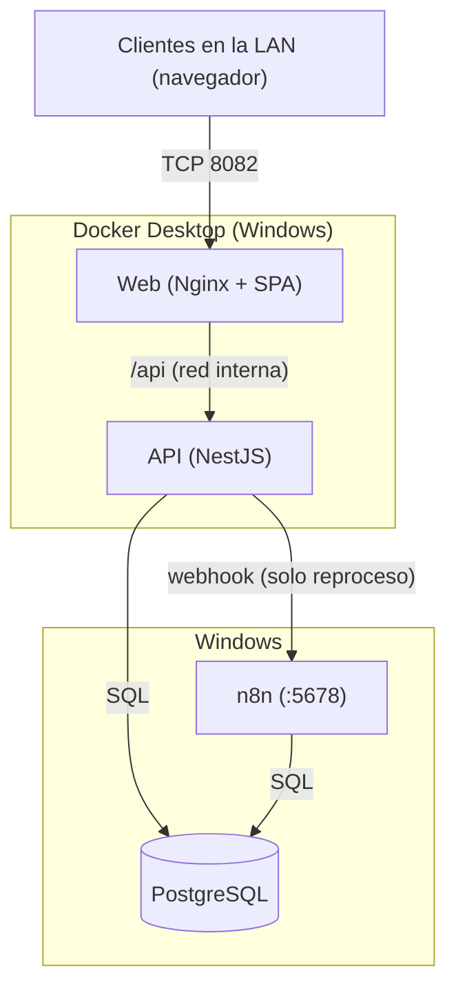

# Daubert Hub

## Descripción

Daubert Hub es la aplicación web interna de Daubert México para administrar el catálogo operativo de la empresa y supervisar sus automatizaciones. Se usa desde el navegador, dentro de la red local (LAN).

Funciones principales:

- **Catálogo**: proveedores, clientes, contactos (con sus medios de contacto), alias comerciales y direcciones de empresa, sobre un modelo común de empresas.
- **Automatizaciones**: estado, historial, reproceso manual y ajuste de folios de Remisiones Audi, Remisiones Caterpillar y Notificaciones de pago. La lógica de las automatizaciones la ejecuta n8n; el Hub lee el estado que n8n deja en PostgreSQL y, en casos puntuales, le pide actuar mediante webhook.
- **Seguridad**: sesiones en servidor, roles `ADMIN` y `GENERAL`, y actividad reciente auditable.

PostgreSQL es la fuente de verdad operativa. El detalle funcional de cada módulo está en [`docs/hub/`](docs/hub/README.md).

## Arquitectura

| Componente | Qué es | Dónde corre |
| --- | --- | --- |
| `apps/web` | SPA React 19 + TypeScript + Vite, servida por Nginx (que también hace proxy de `/api`) | Docker |
| `apps/api` | API REST NestJS 11 + TypeScript | Docker |
| PostgreSQL | Base de datos del Hub y de las automatizaciones | Servicio de Windows (**no** en Docker en PROD) |
| n8n | Ejecuta los workflows de automatización | Windows, con Node.js; lo inicia y supervisa la tarea `Daubert - n8n Supervisor` |

- El navegador solo habla con la Web. La API no publica ningún puerto hacia la LAN; la Web le reenvía `/api`.
- La API se conecta a PostgreSQL y a n8n en el host Windows mediante `host.docker.internal`.
- n8n **no** está expuesto directamente a la LAN. Solo la API lo llama (server-to-server) cuando se solicita un reproceso.
- Web y API no guardan estado propio: las sesiones y los datos viven en PostgreSQL.

Más detalle: [`docs/architecture/README.md`](docs/architecture/README.md) y [`docs/00-overview/architecture.md`](docs/00-overview/architecture.md).

## Estructura del repositorio

| Ruta | Contenido |
| --- | --- |
| `apps/api/` | API NestJS (módulos, seguridad, pruebas unitarias y runners de integración) |
| `apps/web/` | Aplicación React/Vite |
| `docker/` | `Dockerfile` de API y Web, y configuración de Nginx |
| `compose.pilot.yaml` | Stack Docker del Hub (servicios `api` y `web`) |
| `compose.yaml` | Solo desarrollo: contenedor `postgres-test` (PostgreSQL 16, puerto 5433) |
| `deploy/` | Ejemplos de archivos de entorno para TEST/PROD y guía genérica de despliegue |
| `database/` | Migraciones versionadas de `daubert_global` (con precheck/postcheck) |
| `n8n/` | Exports sanitizados de workflows e inventario de n8n |
| `scripts/` | Launcher de desarrollo, y scripts PowerShell de `deploy/`, `server/` (diagnóstico, configuración y supervisor de n8n) y `backup/` |
| `docs/` | Portal documental: arquitectura, operaciones, base de datos, automatizaciones, ADRs y notas de despliegue |

## Entornos

PROD y TEST usan bases de datos, roles, puertos y archivos de entorno distintos. **No se comparte base de datos entre entornos** y no deben mezclarse sus usuarios ni su configuración.

| Elemento | TEST | PROD |
| --- | --- | --- |
| Base de datos | `daubert_hub_test` | `daubert_global` |
| Rol de la API | Rol de TEST (ver `deploy/pilot.test.env.example`) | `daubert_hub_app` (mínimo privilegio) |
| `environment` en `GET /api/health` | `TEST` | `PRODUCTION` |
| Puerto Hub (LAN) | Distinto al de PROD (ejemplo: `8081`) | `8082` |
| Proyecto Compose | Propio de TEST | `daubert-hub` |
| Archivo de entorno (no versionado) | `deploy/pilot.test.env` | `deploy/pilot.prod.env` |
| Desarrollo local (`npm run dev`) | Sí, solo contra `daubert_hub_test` | Nunca |

La tabla completa de diferencias y las variables de entorno están en [`docs/00-overview/environments.md`](docs/00-overview/environments.md).

## Puertos

| Puerto | Uso | Publicado a la LAN |
| --- | --- | --- |
| **8082** | Web del Hub (TCP 8082 del host → puerto 80 del contenedor `web`) | **Sí**: único puerto de acceso LAN |
| 3000 | API (interno de Docker, vía `expose`) | No |
| 5432 | PostgreSQL (servicio de Windows) | No |
| 5678 | n8n (Windows) | No |

Los puertos 3000, 5432 y 5678 no deben quedar accesibles desde la LAN. En desarrollo local, la API usa 3000 y Vite 5173 en la máquina del desarrollador.

## Desarrollo local

Requisitos: Node.js y npm. Comandos reales (ver `package.json`):

1. `npm install`
2. Copiar `apps/api/.env.example` a `apps/api/.env` y definir `TEST_DATABASE_URL` apuntando a `daubert_hub_test` (no usar credenciales de PROD).
3. `npm run dev` levanta API (`:3000`) y Web (`:5173`). **Se niega a arrancar** si `TEST_DATABASE_URL` no apunta exactamente a `daubert_hub_test`, y la API vuelve a verificar la base conectada. `GET /api/health` debe reportar `"environment":"TEST"`.

| Script | Descripción |
| --- | --- |
| `npm run dev` / `npm run dev:test` | API + Web contra `daubert_hub_test` |
| `npm run dev:api` | Solo la API |
| `npm run dev:web` | Solo Vite (no inicia la API) |
| `npm run build` | Compila API y Web |
| `npm run typecheck` · `npm run lint` | Verificación de tipos y ESLint en ambos workspaces |
| `npm run test` | Pruebas unitarias (Vitest) |
| `npm run test:integration` | Runners de integración (requiere `TEST_DATABASE_URL`) |
| `npm run test:dev-guard` | Pruebas del launcher que fuerza TEST |
| `npm run validate` | typecheck + lint + test + test:integration + build |

Los runners de Caterpillar y de ajuste de folios tienen scripts propios y no entran en `test:integration`; ver [`docs/automations/caterpillar/testing.md`](docs/automations/caterpillar/testing.md).

## TEST

- El desarrollo y las pruebas de integración siempre corren contra `daubert_hub_test`; los guards rechazan cualquier otra base.
- El stack Docker de TEST se levanta con su propio proyecto Compose y `deploy/pilot.test.env` (creado desde `deploy/pilot.test.env.example`). Los comandos están en [`deploy/README.md`](deploy/README.md).
- Las migraciones se aplican manualmente en ambos entornos: [`docs/database/migrations.md`](docs/database/migrations.md).

## PROD

- Web y API corren en Docker (proyecto Compose `daubert-hub`, puerto `8082`); PostgreSQL (`daubert_global`) y n8n corren directamente en Windows.
- El despliegue lo ejecuta el script local `scripts/deploy/Deploy-DaubertHub.ps1`, que recrea únicamente `api` y `web`. Un despliegue del Hub no ejecuta migraciones ni cambia n8n, firewall o router.
- El proyecto `daubert-hub` también es el proyecto por defecto de `compose.yaml` (desarrollo). Por eso **no se usa `docker compose down` ni `--remove-orphans` sobre PROD**.
- Procedimiento y checklist: [`docs/operations/deployment-checklist.md`](docs/operations/deployment-checklist.md) y [`docs/operations/deployment.md`](docs/operations/deployment.md). Historial de releases: [`docs/deployments/`](docs/deployments/README.md).

## Servidor Daubert Hub

El host Windows que ejecuta PROD cuenta con documentación y scripts propios (`scripts/server/`):

- **Diagnóstico** (solo lectura): [`docs/operations/diagnose-daubert-server.md`](docs/operations/diagnose-daubert-server.md)
- **Configuración por fases** (firewall, bloqueo LAN de n8n, supervisor de n8n, ACL de secretos, verificación): [`docs/operations/configure-daubert-server.md`](docs/operations/configure-daubert-server.md)
- **Arranque y supervisión de n8n**: la tarea de Task Scheduler `Daubert - n8n Supervisor` (descrita en el documento de configuración, fase 3).

Los respaldos de PostgreSQL y de n8n están en [`docs/operations/README.md`](docs/operations/README.md).

## Documentación

| Área | Enlace |
| --- | --- |
| Portal general | [`docs/README.md`](docs/README.md) |
| Arquitectura | [`docs/architecture/README.md`](docs/architecture/README.md) · [`docs/00-overview/`](docs/00-overview/README.md) |
| Operaciones | [`docs/operations/README.md`](docs/operations/README.md) |
| Deployment | [`deploy/README.md`](deploy/README.md) · [`docs/operations/deployment.md`](docs/operations/deployment.md) · [`docs/operations/deployment-checklist.md`](docs/operations/deployment-checklist.md) · [`docs/deployments/`](docs/deployments/README.md) |
| Desarrollo (Hub: API, Web, auth, roles) | [`docs/hub/README.md`](docs/hub/README.md) |
| Base de datos y migraciones | [`docs/database/README.md`](docs/database/README.md) · [`docs/database/migrations.md`](docs/database/migrations.md) |
| Automatizaciones y n8n | [`docs/automations/README.md`](docs/automations/README.md) · [`n8n/README.md`](n8n/README.md) |
| Pruebas | [`docs/automations/caterpillar/testing.md`](docs/automations/caterpillar/testing.md) · [`docs/automations/audi/testing.md`](docs/automations/audi/testing.md) · [`docs/automations/payment-notifications/testing.md`](docs/automations/payment-notifications/testing.md) |
| Decisiones (ADRs) | [`docs/decisions/README.md`](docs/decisions/README.md) |

## Estado actual

Estado detallado de módulos, pendientes y riesgos: [`docs/00-overview/project-status.md`](docs/00-overview/project-status.md).

- **Hub PROD operativo**, orientado a uso interno en la LAN (V1).
- Web y API desplegadas mediante Docker.
- PostgreSQL corre como servicio de Windows; n8n corre en Windows.
- n8n cuenta con un supervisor mediante Task Scheduler (`Daubert - n8n Supervisor`): arranca al iniciar sesión del usuario con 1 minuto de retraso, evita instancias duplicadas, adopta una instancia ya existente y reinicia n8n con espera creciente si termina.
- El acceso desde Internet no forma parte de V1. Mejoras posteriores contempladas: reserva DHCP, DNS interno, HTTPS, Tailscale/Cloudflare y conexión por Ethernet.

Este archivo no contiene contraseñas, secretos ni credenciales.
