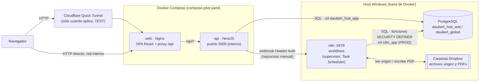

# Arquitectura general de Daubert Hub

Fuentes: `docker/nginx.conf`, `compose.pilot.yaml`, `deploy/README.md`, `apps/api/src/main.ts`, `apps/api/src/app.module.ts`, `apps/api/src/security/*`, `apps/api/src/config/environment.ts`.

## Diagrama

## Flujo Browser → Web → API → PostgreSQL / n8n

1. El navegador sólo habla con el puerto publicado por el contenedor `web` (`HUB_PORT`: 8082 en PROD real; 8081 en el ejemplo de TEST). En la LAN solo se accede por ese puerto.
2. Nginx sirve la SPA compilada (`try_files … /index.html`) y reenvía `/api` y `/api/*` sin modificar a `api:3000` en la red bridge `pilot`, preservando el `Host` del navegador (lo necesita la protección CSRF por Origin, ver [authentication](../hub/authentication.md)).
3. La API no publica puerto al host. Se conecta a PostgreSQL en `host.docker.internal:5432`.
4. La API **nunca** deja que el navegador llame a n8n: cuando hay que pedirle algo a n8n (reproceso manual de Caterpillar o de Notificaciones de pago), lo hace **server-to-server** con un token que sólo existe en el entorno de la API.
5. n8n escribe y lee PostgreSQL por su cuenta (rol `n8n_app` en PROD) y trabaja con los archivos de Dropbox. El Hub no toca el filesystem ni Dropbox: `pdf_path` se muestra como texto plano.

## Autenticación y roles (resumen)

- Sesión server-side en PostgreSQL (`security.sessions`), cookie `daubert_session` (`HttpOnly`, `SameSite=Strict`, path `/api`), vida absoluta de 12 h.
- Guards globales, en orden: CSRF por Origin → autenticación → cambio de contraseña obligatorio → roles.
- Roles: `ADMIN` y `GENERAL`. Detalle en [hub/authentication.md](../hub/authentication.md) y [hub/authorization.md](../hub/authorization.md).

## Entornos y separación TEST / PROD

Dos bases, dos roles de aplicación, dos stacks Docker con `--project-name` distinto, sin base compartida. `GET /api/health` (público) informa `environment` = `TEST` / `PRODUCTION` / `UNKNOWN` derivado de `current_database()`. Detalle y tabla de diferencias en [environments.md](environments.md).

## Cloudflare

Los comentarios del código (`apps/api/src/main.ts`, `security/csrf-origin.guard.ts`) describen una topología TEST histórica con **Cloudflare Quick Tunnel** (temporal, TLS termina en el túnel y el salto local hacia Nginx es HTTP). Por eso HSTS está desactivado en la API y la comparación de Origin ignora el esquema. En PROD V1 el acceso es **solo por LAN** (TCP 8082, HTTP); Cloudflare/Tailscale y HTTPS son mejoras posteriores. Ver [arquitectura self-hosted V1](../architecture/README.md).

## Qué NO hace cada capa

| Capa | No hace |
| --- | --- |
| Web | No decide seguridad (el ocultar botones es UX; la autoridad es la API). No llama a n8n. |
| API | No reimplementa idempotencia ni reglas de folios de las automatizaciones; las delega a PostgreSQL/n8n. No accede a Dropbox. |
| n8n | No usa `postgres`; usa un rol de mínimo privilegio y funciones `SECURITY DEFINER`. |
| PostgreSQL | No es accedido por el navegador; los cambios de folio pasan por API (Hub) o funciones (n8n). |
