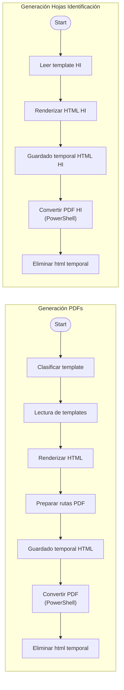
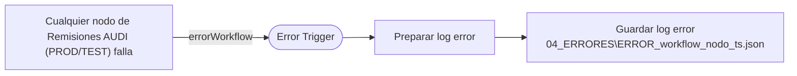

# Audi — Flujo lógico

Fuente: `connections` y código reales de [prod/workflow.json](../../../n8n/workflows/remisiones-audi/prod/workflow.json) y los [subworkflows](../../../n8n/workflows/remisiones-audi/shared/). Nombres exactos: [nodes-reference.md](nodes-reference.md).

## Flujo principal (PROD, cada 15 minutos)

```mermaid
flowchart TD
    S([Schedule Trigger · 15 min]) --> LA["Leer automatización Audi<br/>ops.automatizaciones × series_documentales"]
    MT([Manual]) --> LA
    LA --> VC["Validar configuración PostgreSQL<br/>automatización ACTIVA · serie REMISION_AUDI ACTIVA"]
    VC --> BP["Buscar programaciones Audi<br/>escanea CLIENTES\AUDI"]
    BP --> PV[Preparar validación candidato PG]
    PV --> VP["Validar candidato PG<br/>¿ya COMPLETADA o PROCESANDO?"]
    VP --> EP["Elegir archivo pendiente PG<br/>toma el primero no completado ni en proceso"]
    EP --> PT[Preparar archivo trigger]
    PT --> IT[Ignorar archivos temporales]
    IT --> LC["Leer cliente Audi PG"]
    LC --> VCL[Validar cliente Audi PG]
    VCL --> PD[Preparar documento origen PG]
    PD --> RD["Registrar documento origen PG<br/>INSERT core.documentos si no existe"]
    RD --> PP[Propagar documento PG]
    PP --> VI["Validar idempotencia PG"]
    VI --> CI{"Control idempotencia PG<br/>¿ya completado?"}
    CI -->|sí| STOP([Termina sin efectos])
    CI -->|no| CE["Crear ejecución PG<br/>INSERT ejecuciones · PROCESANDO"]
    CE --> PE[Propagar ejecución PG]
    PE --> LD[Leer archivo disparador] --> GC["Guardar copia en entrada<br/>Copy-Item → 01_ENTRADA"] --> LCP[Leer copia en entrada]
    LCP --> X[Extraccion de informacion de excel]
    X --> LK[Leer catálogo productos] --> EK[Extracción catalogo productos] --> PK[Preparar catalogo productos]
    PK --> N["Normalizar datos"]
    N --> PC[Preparar conteo remisiones PG]
    PC --> RF["Reservar folios PostgreSQL<br/>operacion.reservar_folios('REMISION_AUDI', n)"]
    RF --> AN[Asignar no.Rem PG]
    AN --> CP["Call Generación PDFs<br/>(subworkflow)"]
    CP --> PR[Preparar remisiones generadas PG]
    PR --> RR["Registrar remisiones generadas PG<br/>INSERT remisiones + detalle"]
    RR --> RH[Recuperar datos para HI]
    RH --> HI["Generación Hojas Identificación<br/>(subworkflow)"]
    HI --> CC["Cerrar ejecución COMPLETADA PG<br/>UPDATE estado"]
    CC --> PL[Preparar log ejecución] --> GL[Guardar log ejecución]
```

## Subworkflows

## Manejo de errores

El manejador **no** actualiza PostgreSQL. No hay salidas de error internas en el workflow.

## Reglas verificadas

| Tema | Verificado en el export |
| --- | --- |
| **Trigger** | `Schedule Trigger` cada **15 min** (zona `America/Mexico_City` en `settings`) y disparo manual. |
| **Excel origen** | `.xlsx`, sin temporales `~$`, nombre que contiene "programacion de entrega" y "audi" (o ruta `\clientes\audi\`). Escaneo bajo `CLIENTES\AUDI\<año>` para años actual-1 … actual+1, en carpetas de "información adicional", **recursivo** excepto subcarpetas *remisiones*, *facturas*, *recibida(s)*. Antigüedad entre 2 min y 60 días. |
| **Selección** | Ordena por fecha de modificación **ascendente**, revisa hasta **20** candidatos; PostgreSQL descarta los ya `COMPLETADA` o `PROCESANDO`; se procesa el **primero** pendiente por ciclo. ⚠️ Ver riesgo de acumulación en [troubleshooting](troubleshooting.md#3-no-se-procesa-un-archivo-nuevo). |
| **Proveedor/cliente** | Se localiza la empresa Audi con búsqueda de texto y debe haber **exactamente una**. (El "proveedor" de las remisiones es Audi como cliente.) |
| **Idempotencia** | Dos capas: `Validar candidato PG` (excluye completadas/en proceso) y `Validar idempotencia PG`/`Control idempotencia PG` (si el documento ya tiene ejecución `COMPLETADA`, termina). El documento se identifica por **ruta** (sin hash): un Excel **sobrescrito en la misma ruta** se considera el mismo documento. |
| **Catálogo / clasificación** | El catálogo `Catalogo_Productos_Audi.xlsx` (hoja `Catalogo_Productos`) da el formato (`formato_audi`: *tubos* / *bolsas*). `Clasificar template` usa: 1) catálogo, 2) fallback: números de parte `A15MEAW` y `A15MEAV` ⇒ tubos, 3) por defecto **bolsas**. Plantillas `REM-Template-Audi-Tubos.html` / `…-Bolsas.html`. |
| **Artículos y cantidades** | `Normalizar datos` interpreta la programación y calcula presentaciones ("bags per roll/pack", "Kg per roll", etc.). **Filas leídas:** sólo las filas 8 a 13 del Excel (`rows.slice(7, 13)`), es decir, **máximo 6 artículos por archivo**; una fila cuenta si tiene código interno, descripción, número de parte (columna I) y cantidad (columna K). **Artículos con cantidad cero** (`isCantidadCero`) se **excluyen**; si **no queda ninguno**, lanza error ("No se encontraron productos válidos con cantidad mayor a cero"). Artículos por encima de la fila 13 se ignoran sin aviso. |
| **Folios** | `operacion.reservar_folios('REMISION_AUDI', n)` (allocator legado, **sin** reserva ligada a ejecución). `Asignar no.Rem PG` exige que lo reservado coincida con el número de remisiones y asigna folios consecutivos con 4 dígitos. Contador JSON: **no se usa** en PROD. |
| **PDF** | HTML por remisión → PDF vía `convertir-audi-pdf.ps1`; salida en `02_SALIDAS\REMISIONES`. |
| **Hojas de identificación** | Una hoja por artículo, en un PDF `Hojas Identificacion Audi T N<n> <fecha>.pdf` en `02_SALIDAS\HOJAS_IDENTIFICACION`. Exige cantidad por hoja. **No** hay división por tarimas. |
| **Registro** | `Registrar remisiones generadas PG` inserta remisiones (`GENERADA`) y detalle **sólo si no existe** ya (serie+folio no cancelado). |
| **Cierre** | `UPDATE ... estado = 'COMPLETADA'` sólo si sigue `PROCESANDO`. |
| **Log** | `Guardar log ejecución` escribe `03_LOGS\log_<run_name>.csv`. |
| **Movimiento de archivos** | El original **no se mueve ni se borra**; se copia a `01_ENTRADA`. |

## Qué ocurre en los casos habituales

| Situación | Resultado |
| --- | --- |
| Sin archivos nuevos | `Elegir archivo pendiente PG` no emite nada; el ciclo termina; no se crea ejecución. |
| Archivo ya completado | Descartado por `Validar candidato PG` / `Control idempotencia PG`. |
| Fallo antes de `Crear ejecución PG` (p. ej. cliente ambiguo, catálogo vacío) | El error dispara el manejador (log). Como no hay ejecución, el archivo sigue siendo candidato y **se reintenta en el siguiente ciclo**. |
| Fallo **después** de `Crear ejecución PG` | El manejador escribe log; la ejecución queda `PROCESANDO`; el archivo **deja de ser candidato** (excluido por `ya_procesando_pg`) hasta intervención manual. Si falló después de reservar folios, esos folios **quedan consumidos** sin remisión. |
| Cero artículos válidos | Error de `Normalizar datos` (ver arriba). |
