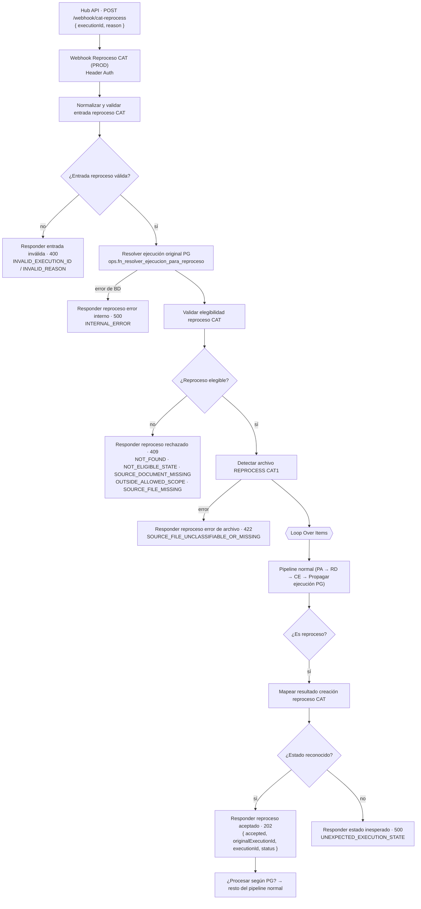

# Caterpillar — Flujo lógico (n8n)

> **Procedencia (Fase D2).** Verificado contra los exports reales: [`n8n/workflows/remisiones-caterpillar/prod/workflow.json`](../../../n8n/workflows/remisiones-caterpillar/prod/workflow.json) (`Remisiones CAT Produccion PG`, activo) y [`test/workflow.json`](../../../n8n/workflows/remisiones-caterpillar/test/workflow.json) (`MANUAL TEST REMISIONES CAT`). Los diagramas salen de las `connections` reales. Nombres de nodo exactos: [nodes-reference.md](nodes-reference.md). Diferencias TEST/PROD: [n8n-test-prod-drift](../n8n-test-prod-drift.md#caterpillar).

Un **solo workflow** contiene dos ramas de entrada que **convergen** en el nodo `Loop Over Items`:

- **Normal**: `Schedule Trigger` (cada 10 min) o `When clicking ‘Execute workflow’` (manual) → `Detectar archivos CAT1`.
- **Reproceso**: `Webhook Reproceso CAT (PROD)` (`POST /webhook/cat-reprocess`, Header Auth) → … → `Detectar archivo REPROCESS CAT1` → `Loop Over Items`.

Después de `Loop Over Items` ambas ramas comparten el mismo pipeline. **No hay Error Workflow** configurado (`settings` sin `errorWorkflow`); el manejo de fallos es interno (salidas de error de dos nodos).

## Flujo normal

```mermaid
flowchart TD
    S([Schedule Trigger · 10 min]) --> D["Detectar archivos CAT1<br/>escanea RUTAS_REALES"]
    M([Manual]) --> D
    D --> F["Filtrar archivos nuevos<br/>corte 2026-09-22 · más antiguos primero"]
    F --> L{{"Loop Over Items"}}
    L -->|un archivo| PA["Preparar archivo CAT<br/>SHA-256, rutas, run_name"]
    PA --> RD["Resolver documento origen PG<br/>core.fn_crear_o_resolver_documento"]
    RD --> PD[Propagar documento origen PG]
    PD --> CE["Crear o recuperar ejecución PG<br/>ops.fn_crear_ejecucion_automatizacion"]
    CE --> PE["Propagar ejecución PG<br/>valida motivo"]
    PE --> ER{"¿Es reproceso?"}
    ER -->|no| PP{"¿Procesar según PG?"}
    ER -->|sí| MR[Mapear resultado creación reproceso CAT]
    MR --> RK{"¿Estado de reproceso reconocido?"}
    RK -->|sí| RA["Responder reproceso aceptado · 202"]
    RK -->|no| RX["Responder estado inesperado · 500"]
    RA --> PP
    PP -->|no: ALREADY_*| L
    PP -->|sí: CREATED / REPROCESS_CREATED / ALREADY_PROCESSING| C1["Catálogo Caterpillar<br/>Leer → Extraer productos/clientes → Preparar"]
    C1 --> LA[Leer archivo detectado]
    LA --> GC[Guardar copia en entrada] --> LC[Leer copia en entrada]
    LC --> X[Extraccion de informacion de excel]
    X --> N["Normalizar datos CAT"]
    N -->|ok| PR["Preparar reserva folios PG"]
    PR --> RF["Reservar folios PG<br/>operacion.reservar_folios_para_ejecucion"]
    RF --> AF[Asignar folios PG CAT]
    AF --> RH[Renderizar HTML] --> GH[Guardar HTML temporal] --> PC[Preparar conversión PDF CAT]
    PC --> CP["Convertir PDF CAT<br/>PowerShell"]
    CP -->|ok| PRR[Preparar registro remisiones PG]
    PRR --> RR["Registrar remisión PG<br/>operacion.fn_registrar_remision_generada"]
    RR --> EH[Eliminar HTML temporal CAT]
    EH --> PF[Preparar finalización PG]
    PF --> FE["Finalizar ejecución PG<br/>estado COMPLETADA"]
    FE --> L
    N -->|error| PER[Preparar error CAT]
    CP -->|error| PER
    PER --> RFA["Registrar fallo PG<br/>ops.fn_registrar_fallo_ejecucion"]
    RFA --> LG["Registrar log error CAT<br/>04_ERRORES"]
    LG --> LH[Limpiar HTML temporal por error CAT]
    LH --> L
```

### Puntos verificados

| Aspecto | Verificado en el export |
| --- | --- |
| **Schedule** | `minutesInterval: 10`. También hay un disparo manual. |
| **Detección** | `Detectar archivos CAT1` escanea las `RUTAS_REALES` (P2, Nuevo Laredo, P3-P6, Legacy, Torreón), Excel (`.xlsx/.xlsm/.xls`), sin temporales `~$`, con el patrón `PROGRAMACION DE ENTREGA` (Legacy: `SOLICITUD DE MATERIAL`, nunca se procesa). En enero revisa el año anterior y el actual; el resto del año, sólo el actual. En PROD `ACTIVAR_APARTADO_PRUEBAS = false` y `ACTIVAR_RUTAS_REALES = true`. |
| **Clasificación** | Por modo de ruta: `FIJO` (P2), `FINSA` (Nuevo Laredo: sólo FINSA 1/3), `P3P6` (por "PLANTA/PL n" en el nombre; "SC PLANTA 3" ⇒ P3), `TORREON` (subplanta opcional `PLANTA_n`). Genera `llave_proceso = cliente_grupo|planta|subplanta`. |
| **Procesos habilitados** | `PROCESOS_HABILITADOS_PROD` = `CATERPILLAR_P2|P2|`, `CAT_P3_P4_P5_P6|P5|`, `CAT_P3_P4_P5_P6|P6|`. Está **copiada** en `Detectar archivos CAT1` y en `Validar elegibilidad reproceso CAT` (deben mantenerse en paralelo). El resto se detecta pero no se procesa. |
| **Corte** | `Filtrar archivos nuevos` descarta archivos con fecha < `2026-09-22T00:00:00-06:00`; sin fecha confiable ⇒ no se procesa. Ordena del más antiguo al más reciente. **No** consulta contadores JSON (PostgreSQL decide "ya procesado"). |
| **Documento origen** | `Preparar archivo CAT` calcula SHA-256, `run_name` y las rutas de trabajo. `Resolver documento origen PG` llama `core.fn_crear_o_resolver_documento` con un `empresa_id` **fijo en el nodo** (Caterpillar), tipo `PROGRAMACION_ENTREGA`, origen `DROPBOX`, fecha y hash. |
| **Ejecución** | `Crear o recuperar ejecución PG` llama `ops.fn_crear_ejecucion_automatizacion('REMISIONES_CATERPILLAR', documento, $execution.id, run_name, reproceso_de_id)`. `Propagar ejecución PG` acepta `CREATED`, `REPROCESS_CREATED`, `ALREADY_PROCESSING` (procesables) y `ALREADY_COMPLETED/ERROR/CANCELLED/REPROCESSED` (no procesables); cualquier otro motivo lanza error. |
| **Serie** | `Preparar reserva folios PG` mapea planta → serie (`REMISION_CAT_P2 … _P6`, `_NL_FINSA_1/3`, `_TORREON`); `cantidad` = número de remisiones normalizadas. La reserva es **una por archivo/serie**. |
| **Remisiones** | Normal: **una remisión por artículo**; Torreón: **una remisión por OC** con varios artículos. Catálogo estricto (`MODO_ESTRICTO_CATALOGO = true`); `MODO_ESTRICTO_TORREON_FINANZAS = false`. Un renglón de detalle por remisión en `Registrar remisión PG`. |
| **PDF** | `Renderizar HTML` (plantilla `REM-Plantilla-CAT.html` o `REM-Plantilla-CAT-TORREON.html`) → HTML temporal → `Convertir PDF CAT` ejecuta un script PowerShell externo (`convertir-cat-pdf.ps1`) → `Eliminar HTML temporal CAT` (`limpiar-temp-cat.ps1`). Nombre `REM <no. 4 dígitos> <parte>.pdf`. |
| **Finalización** | `Preparar finalización PG` exige tantos registros como remisiones esperadas; `Finalizar ejecución PG` con `COMPLETADA`. |
| **Fallos** | Sólo `Normalizar datos CAT` y `Convertir PDF CAT` tienen salida de error (`continueErrorOutput`) hacia `Preparar error CAT` → `Registrar fallo PG` → `Registrar log error CAT` → `Limpiar HTML temporal por error CAT` → `Loop Over Items`. Un fallo en **cualquier otro** nodo aborta la ejecución n8n **sin** registrarla en PostgreSQL. |

### Casos del trigger (verificados)

| Situación | Qué ocurre |
| --- | --- |
| **Hay archivos** | Pasan detección, corte y clasificación; cada uno entra a `Loop Over Items`. |
| **No hay archivos** | `Detectar archivos CAT1` no emite candidatos; el ciclo termina; **no se crea documento, ejecución ni reserva**. |
| **Archivo ya procesado** | `fn_crear_ejecucion_automatizacion` devuelve `ALREADY_COMPLETED/ERROR/CANCELLED`; `procesar_segun_pg = false`; el ítem vuelve a `Loop Over Items` sin más efectos. (Efecto colateral: `core.fn_crear_o_resolver_documento` y el hash se calculan en cada ciclo para todo candidato posterior al corte.) |
| **Archivo no procesable** | No clasificable (planta no reconocida, FINSA no 1/3, patrón/extensión inválidos, Legacy) **no sale de `Detectar archivos CAT1`** como procesable: nunca llega a PostgreSQL. Error de normalización o PDF: salida de error → `Registrar fallo PG` (reintentos según `max_intentos` de la BD). |
| **Proceso inactivo** | Un proceso fuera de `PROCESOS_HABILITADOS_PROD` no se procesa (Detectar). Además PostgreSQL rechaza reservar en series `INACTIVA` (`55000`). |

### Reintentos

Tras un fallo controlado, `fn_registrar_fallo_ejecucion` incrementa `intentos_fallidos`; mientras queden intentos la ejecución sigue `PROCESANDO`, y el siguiente ciclo la recibe como `ALREADY_PROCESSING` (procesable) y **la retoma** (se reintenta sobre la misma ejecución, sin crear otra). Al alcanzar `max_intentos` pasa a `ERROR` con sus reservas `ABANDONADA`.

## Flujo de reproceso (Webhook)

### Puntos verificados del reproceso

| Aspecto | Verificado |
| --- | --- |
| **Entrada** | Sólo `executionId` y `reason`. `executionId`: `^[1-9][0-9]{0,18}$`. `reason` no vacío. No se lee ninguna otra cosa del body. |
| **Resolución** | `ops.fn_resolver_ejecucion_para_reproceso($1)`; ruta y nombre de archivo salen de `core.documentos`, **nunca** del body. |
| **Elegibilidad (orden real)** | (1) `encontrada = false` → `NOT_FOUND`; (2) estado ∉ {`ERROR`,`CANCELADA`} → `NOT_ELIGIBLE_STATE`; (3) faltan `documento_origen_id`/ruta/nombre → `SOURCE_DOCUMENT_MISSING`; (4) ruta fuera de `RUTAS_REALES` (segmentos reales, `path.win32`), nombre que no coincide, o clasificación no procesable / fuera de `PROCESOS_HABILITADOS_PROD` → `OUTSIDE_ALLOWED_SCOPE`; (5) el archivo no existe en disco → `SOURCE_FILE_MISSING`. |
| **Archivo** | `Detectar archivo REPROCESS CAT1` arma el ítem `ARCHIVO_DETECTADO` con `mode: "REPROCESS"`, `reproceso_de_id`, `reproceso_reason`; **no** vuelve a aplicar corte ni "ya procesado". |
| **Hija** | `Crear o recuperar ejecución PG` recibe `reproceso_de_id` ⇒ `REPROCESS_CREATED` / `ALREADY_PROCESSING` / `ALREADY_REPROCESSED`. |
| **Respuesta aceptada** | HTTP **202** para los tres estados (incluido `ALREADY_REPROCESSED`); el campo `status` es el motivo crudo de PostgreSQL. La respuesta se envía **antes** de terminar el pipeline: 202 ≠ reproceso terminado. |
| **Rechazos** | HTTP 409 con `{ accepted: false, error }` (todos los rechazos de elegibilidad, incluido `NOT_FOUND`). |

> ⚠️ **Discrepancias con el Hub** (ver [reprocessing.md](reprocessing.md#discrepancias-hub--n8n-verificadas-en-d2)): el workflow puede devolver `SOURCE_DOCUMENT_MISSING`, `SOURCE_FILE_UNCLASSIFIABLE_OR_MISSING` (422), `INVALID_EXECUTION_ID`/`INVALID_REASON` (400), `INTERNAL_ERROR` y `UNEXPECTED_EXECUTION_STATE` (500), que el Hub **no** reconoce (los trata como fallo upstream → 502).

## Qué comparte y qué difiere TEST

TEST tiene la misma estructura con `Webhook Reproceso CAT (TEST)` (`cat-test-reprocess`), `Filtrar solo pruebas locales1` (aislamiento a la carpeta de pruebas) y otras diferencias de entorno: ver [n8n-test-prod-drift](../n8n-test-prod-drift.md#caterpillar).

## Invariantes que el workflow respeta (y que PostgreSQL impone)

- La ejecución original no se modifica; el reproceso crea una hija.
- Un padre tiene como máximo un hijo directo.
- Un reproceso reserva folios nuevos.
- Toda finalización `COMPLETADA` exige tantas remisiones `GENERADA` como folios reservados.
