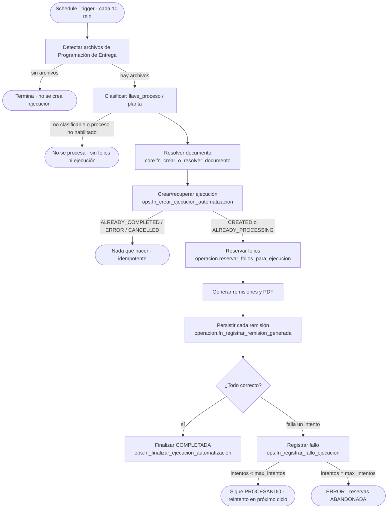
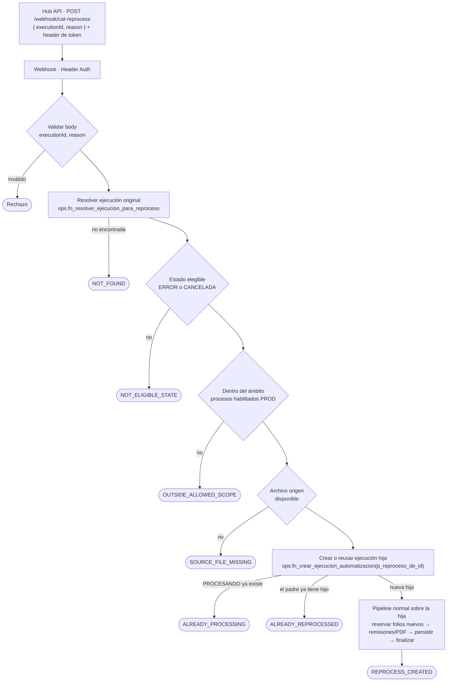

# Caterpillar — Flujo lógico (n8n)

> **Procedencia.** Los workflows n8n **no están versionados en este repositorio**. El flujo lógico de abajo proviene de la *Descripción de proyecto* (brief de la Fase D1) y de la nota de despliegue 12C, y es **coherente** con las funciones de PostgreSQL y el contrato del Hub (esas partes sí están verificadas en código/SQL y se indican). Los nombres de nodos **no se conocen desde el repo**: PENDIENTE de extraer del export del workflow. Ver el marcado en cada sección.

Workflow PROD activo: **`Remisiones CAT Produccion PG`** (incluye la rama de reproceso desde 12C). El workflow anterior a 12C permanece **inactivo** como rollback. **Nunca** deben estar ambos activos: comparten el mismo schedule ([runbook](production-runbook.md#workflows)).

## Flujo normal (Schedule cada 10 minutos)

Qué está verificado en SQL: los nombres y semántica de las funciones, los motivos de `fn_crear_ejecucion_automatizacion`, la política de reintentos y la finalización. Qué es *Descripción de proyecto*: el orden exacto de nodos, la detección de archivos y el gating por proceso.

### Casos del trigger

| Situación | Qué ocurre | Evidencia |
| --- | --- | --- |
| **Hay archivos** | Cada archivo se clasifica y entra al pipeline. Una ejecución por documento origen. | Descripción de proyecto + modelo de datos |
| **No hay archivos** | El ciclo termina sin efecto; no se crean documentos, ejecuciones ni reservas, y **no se consumen folios**. | Descripción de proyecto |
| **Archivo ya procesado** | `fn_crear_ejecucion_automatizacion` devuelve `ALREADY_COMPLETED`/`ALREADY_ERROR`/`ALREADY_CANCELLED` (según el estado terminal más reciente, reprocesos incluidos): no se crea otra ejecución. Si hay una `PROCESANDO`, devuelve `ALREADY_PROCESSING` (evita ejecuciones concurrentes). | SQL (009) |
| **Archivo no procesable** (no clasificable, sin ruta) | `ops.fn_resolver_ruta_automatizacion` no devuelve fila para una `llave_proceso` inexistente o de ruta `INACTIVA` (**falla cerrado**; verificado por el runner `caterpillar-model`). Qué hace el workflow con ese archivo (ignorar/registrar/alertar): PENDIENTE. Si el fallo ocurre **después** de crear la ejecución, se registra con `fn_registrar_fallo_ejecucion`. | SQL + PENDIENTE |
| **Proceso inactivo / no habilitado** | Dos capas: (1) el workflow PROD sólo procesa los procesos de `PROCESOS_HABILITADOS_PROD` (*Descripción de proyecto*; esa variable **no está en el repo**); (2) PostgreSQL rechaza reservar de una serie `INACTIVA` (SQLSTATE `55000`) y `fn_resolver_ruta_automatizacion` ignora rutas `INACTIVAS`. Nunca se avanza un folio de una serie inactiva. | Descripción de proyecto + SQL |

### Reintentos

`ops.ejecuciones_automatizacion` lleva `intentos_fallidos` y `max_intentos`. Cada fallo (identificado por `n8n_execution_id`, sin doble conteo del mismo run) incrementa el contador y mantiene la ejecución en `PROCESANDO` mientras queden intentos; al llegar al máximo pasa a `ERROR` y las reservas a `ABANDONADA`. Los valores de `max_intentos` se leen de la base (no se documentan números aquí para no inventarlos).

## Flujo de reproceso manual (Webhook)

Respuesta al Hub (contrato verificado en `caterpillar-reprocess-webhook.client.ts`):

- Aceptado: `{ accepted: true, status, originalExecutionId, executionId }` con `status` ∈ {`REPROCESS_CREATED`, `ALREADY_PROCESSING`, `ALREADY_REPROCESSED`}; cualquier 2xx se acepta y se valida el cuerpo.
- Rechazado: HTTP 400/404/409/422 con `{ accepted: false, error }` y `error` ∈ códigos conocidos ([reprocessing](reprocessing.md#contrato)).

Verificado en SQL: resolver, estado devuelto, índice único de un hijo por padre y `ALREADY_REPROCESSED`. *Descripción de proyecto*: la secuencia exacta de validaciones en n8n (estado → ámbito → archivo) y qué estados considera elegibles (el brief y la nota 12C hablan de `ERROR`/`CANCELADA`; una `COMPLETADA` devuelve 409 en el smoke test).

## Nombres de nodos para troubleshooting

- Nombres de nodos del workflow: **PENDIENTE** (extraer del export).
- Lo que sí puedes usar hoy: el **nodo que falló** queda en `ops.ejecuciones_automatizacion.error_nodo` (y `error_mensaje`), visible en el Hub como *latestErrorNode / latestErrorMessage* en el detalle de la ejecución. `n8n_execution_id` enlaza la ejecución de PostgreSQL con la ejecución en el editor de n8n.

## Invariantes que el workflow no puede romper

- La ejecución original **no se modifica** por un reproceso.
- Un padre tiene **como máximo un** hijo directo (índice único parcial).
- Un reproceso **reserva folios nuevos**.
- Toda finalización `COMPLETADA` exige que cada reserva tenga exactamente `cantidad` remisiones `GENERADA` en su rango.
