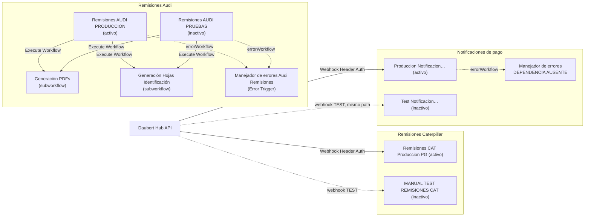

# n8n — Dependencias, subworkflows y manejadores de errores

Fuente: los 12 exports n8n (Fase D2). Complementa [n8n/inventory.md](../../n8n/inventory.md) y [n8n/credentials.md](../../n8n/credentials.md).

## Mapa de dependencias

## Execute Workflow / subworkflows

| Llamador | Nodo | Subworkflow (ID lógico) | ¿Export encontrado? |
| --- | --- | --- | --- |
| Remisiones AUDI PRODUCCION | `Call Generación PDFs` | `Generación PDFs` | Sí |
| Remisiones AUDI PRODUCCION | `Generación Hojas Identificación` | `Generación Hojas Identificación` | Sí |
| Remisiones AUDI PRUEBAS | ídem (mismos dos nodos) | **Los mismos IDs** que PROD | Sí (compartidos) |
| Caterpillar (PROD/TEST/candidato/legado) | — | Ninguno | — |
| Notificaciones de pago (PROD/TEST) | — | Ninguno | — |

Los subworkflows se activan con `Execute Workflow Trigger` (`Start`, `passthrough`). Reciben todo el contexto (rutas base, carpeta de salida, plantillas) desde el llamador, por eso pueden servir a TEST y PROD **a la vez**; pero un cambio en ellos afecta a ambos.

## Error Workflows / manejadores

| Manejador | Entorno | Lo usan | Acciones | BD | Logs / carpetas | Riesgo |
| --- | --- | --- | --- | --- | --- | --- |
| `Manejador de errores Audi Remisiones` (`Error Trigger` → `Preparar log error` → `Guardar log error`) | PROD (compartido) | Audi PROD **y Audi TEST** | Escribe un JSON `ERROR_<workflow>_<nodo>_<timestamp>.json` (`tipo_log: AUDI_ERROR`) | **Ninguna** (no toca PostgreSQL) | `…\HERRAMIENTAS AUTOMATIZACION\REMISIONES AUDI\04_ERRORES` (ruta de PROD **fija**) | **No marca la ejecución como `ERROR` en PostgreSQL**: una falla tras `Crear ejecución PG` deja la ejecución `PROCESANDO` y el archivo queda excluido de futuras detecciones (ver [audi/troubleshooting](audi/troubleshooting.md)). TEST escribe en la carpeta de PROD. Sin notificaciones. |
| Manejador referenciado por Notificaciones PROD (ID `Hk5G…` en `settings.errorWorkflow`) | PROD | Notificaciones PROD | **Desconocido** | Desconocida | Desconocidos | **DEPENDENCIA AUSENTE**: no existe export. No se documenta su contenido. |
| Caterpillar | — | — | Ninguno configurado | — | Los fallos controlados escriben en `04_ERRORES` desde el propio workflow | Fallos en nodos sin salida de error no se registran en PostgreSQL |

## Dependencias externas (no versionadas)

| Tipo | Elemento | Usado por |
| --- | --- | --- |
| Scripts PowerShell | `convertir-cat-pdf.ps1`, `limpiar-temp-cat.ps1` | Caterpillar (`Convertir PDF CAT`, `Eliminar HTML temporal CAT`) |
| Scripts PowerShell | `convertir-audi-pdf.ps1`, `limpiar-temp-audi.ps1` | Audi (subworkflows y flujo principal) |
| Scripts referenciados pero **inexistentes en disco** | `html-to-pdf-cat.ps1` (fallback dentro de `Normalizar datos CAT`, no se usa porque `Preparar archivo CAT` fija `convertir-cat-pdf.ps1`), `limpiar-html-temporal-cat.ps1` | Caterpillar (config legada) |
| Scripts en disco **sin referencia** en los workflows vigentes | `detectar-archivos-cat.ps1`, `eliminar-html-temporal.ps1` | — (posibles restos) |
| Plantillas HTML | `REM-Plantilla-CAT.html`, `REM-Plantilla-CAT-TORREON.html`; `REM-Template-Audi-Bolsas.html`, `REM-Template-Audi-Tubos.html`, `HI-Template-Audi.html`; imagen `DC_logo.jpg`; firma y logos del correo de Notificaciones | Caterpillar, Audi, Notificaciones |
| Catálogos Excel | `Catalogo_Caterpillar.xlsx` (hojas `Productos_por_Planta`, `Clientes_Plantas`), `Catalogo_Productos_Audi.xlsx` (hoja `Catalogo_Productos`), programación semanal de CXP | Caterpillar, Audi, Notificaciones |
| Archivos de estado legados | `contador_*.json`, `archivos_procesados_*.json` (Audi, Caterpillar, Notificaciones: `archivos_procesados.json` **sigue en uso** para duplicados de PDF) | Ver [n8n-paths](n8n-paths.md) |
| Microsoft Graph | `https://graph.microsoft.com/v1.0/me/messages/…` (adjuntos, borradores, firma) vía credencial OAuth2 de Outlook | Notificaciones |
| Vista de PostgreSQL | `core.vw_catalogo_notificacion_pago_n8n` | Notificaciones |
| Daubert Hub | Origen de los webhooks de reproceso | Caterpillar, Notificaciones |
| `instalacion n8n.txt` | Documento de instalación en Dropbox (**no revisado**) | — |

## Otros webhooks

Sólo los dos webhooks del Hub (Caterpillar y Notificaciones). No hay webhooks internos auxiliares ni workflows llamados por HTTP.

## DEPENDENCIA AUSENTE (resumen)

| Referencia | Detalle |
| --- | --- |
| `errorWorkflow` de Notificaciones PROD | Sin export. Confirmar en n8n qué workflow es y versionarlo. |
| Workflow de rollback "previo a 12C" de Caterpillar | No identificable con certeza: ver [production-runbook](caterpillar/production-runbook.md#rollback-aclaración-importante-d2). |
