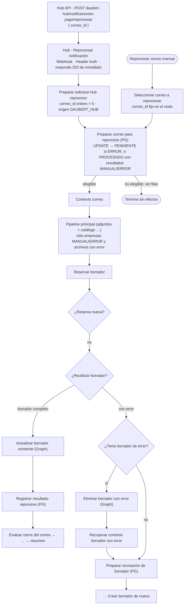
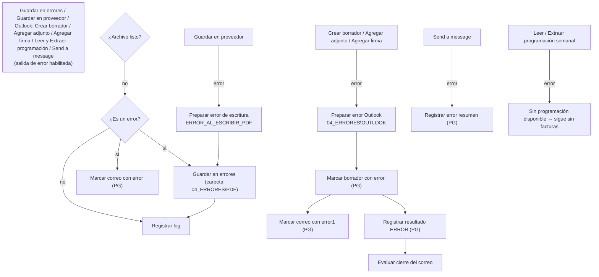

# Notificaciones de pago — Flujo lógico

Fuente: `connections` y código del export PROD `Produccion Notificacion de pagos a Proveedores` (y su comparación con TEST). Nombres exactos: [nodes-reference.md](nodes-reference.md). Los diagramas simplifican agrupando nodos de sincronización (`Merge`).

## Flujo principal

```mermaid
flowchart TD
    S([Schedule Trigger]) --> O["Obtener correos Outlook<br/>carpeta configurada · límite 10"]
    O --> V{"¿Correo válido de pagos?<br/>remitente · adjuntos · asunto PAGO + PROVEEDOR"}
    V -->|sí| VP["Verificar correo procesado (PG)"]
    VP --> N{"¿Correo nuevo?"}
    N -->|sí| T["Tomar un correo por ejecución"]
    T --> RP["Registrar correo pendiente (PG)"]
    RP --> CC[Contexto correo]
    CC --> AD["Obtener adjuntos del correo"] --> Z{"¿Es ZIP?"} -->|sí| DL[Download an attachment]
    CC --> CAT["Consultar catálogo BD → Empaquetar catalogo"]
    DL --> SY["Sincronizar ZIP y catálogo"]
    CAT --> SY
    SY --> ZM[Preparar metadatos ZIP] --> CO["Compression (descomprimir)"] --> SP[Separar archivos descomprimidos]
    SP --> TX[Extraer texto PDF] --> FP["Extraer fecha de pago<br/>'Fecha de aplicación: dd/mm/aaaa'"]
    FP --> CE["Configurar entorno<br/>MODO · rutas"]
    CE --> PS["Buscar programación semanal<br/>→ Leer → Extraer XLSX → Normalizar → Agrupar facturas por empresa"]
    CE --> CI[Calcular identidad PDF] --> CL["Clasificar con catalogo<br/>alias → proveedor · ruta destino"]
    CL --> PE{"¿Procesar en esta ejecución?"}
    PE --> VD["Verificar duplicados<br/>archivos_procesados.json + destino"]
    VD --> AL{"¿Archivo listo?"}
    AL -->|sí, no existe| GP["Guardar en proveedor (escribe el PDF)"]
    AL -->|sí, ya existe| UN
    GP --> UN[Unir archivos listos]
    UN --> AG[Agrupar comprobantes por empresa]
    AG --> SF["Sincronizar comprobantes y facturas"]
    PS --> SF
    SF --> INTF[Integrar facturas con comprobantes] --> VW["Preparar vista previa del correo<br/>asunto, cuerpo, PARA/CC/CCO"]
    VW --> PB{"¿Puede crear borrador?<br/>VISTA_PREVIA_GENERADA · adjuntos > 0 · notificaciones activas"}
    PB -->|sí| RB["Reservar borrador (PG)"] --> RN{"¿Reserva nueva?"}
    RN -->|sí| CB["Microsoft Outlook: Crear borrador"] --> GD[Guardar datos del borrador]
    GD --> SG["Preparar firma → Agregar firma al borrador → Validar firma"]
    SG --> ADJ["Separar comprobantes → Leer comprobante → Preparar adjunto Graph → Agregar adjunto al borrador"]
    ADJ --> VR[Validar resultados Outlook] --> MB["Marcar borrador creado (PG)"]
    MB --> BC{"¿Borrador completo?"}
    BC -->|sí| RL["Registrar resultado LISTO (PG)"]
    BC -->|no| RM["Registrar resultado MANUAL (PG)"]
    PB -->|no| DES{"¿Notificación desactivada?"}
    DES -->|sí| RO["Registrar notificación omitida → Registrar resultado OMITIDO (PG)"]
    DES -->|no| RPN["Registrar pendiente de notificación → Registrar resultado MANUAL (PG)"]
    RL --> EV["Evaluar cierre del correo (PG)"]
    RM --> EV
    RO --> EV
    RPN --> EV
    EV --> TE{"¿Terminó el correo?"} -->|sí| FC["Finalizar correo procesado (PG)<br/>PROCESADO o ERROR"]
    FC --> CR["Consultar resultados para resumen (PG)"] --> RS["Preparar resumen Sofi"] --> SM["Send a message<br/>correo resumen interno"]
    SM -->|ok| MR["Marcar resumen enviado (PG)"]
    SM -->|error| ER["Registrar error resumen (PG)"]
```

## Reproceso (Hub o manual)

## Manejo de errores

Un correo con errores queda `ERROR` en PostgreSQL y puede **reprocesarse** (Hub o manual). No hay Error Workflow interno (en PROD sí se referencia uno externo **sin export**).

## Reglas verificadas

| Tema | Verificado |
| --- | --- |
| **Filtro de correo** (`¿Correo válido de pagos?`) | Remitente del dominio configurado (PROD: administrador de pagos; TEST: dominio interno) **y** con adjuntos **y** asunto con las palabras "PAGO(S)" y "PROVEEDOR(ES)" (normalizado, sin acentos). |
| **ZIP** | `¿Es ZIP?`: nombre `.zip` o tipo `application/zip`/`x-zip-compressed`, no inline. `Compression` descomprime; `Separar archivos descomprimidos` genera un ítem por archivo (error si el ZIP no produce archivos). |
| **PDF** | Se extrae el texto y la **fecha de pago** (`Fecha de aplicación: dd/mm/aaaa`); sin fecha → `FECHA_PAGO_NO_ENCONTRADA`. Archivos no PDF → `ARCHIVO_NO_PDF`. |
| **Clasificación** | `Clasificar con catalogo` resuelve el alias del PDF contra el catálogo de PostgreSQL. Códigos de error: `ALIAS_NO_CATALOGADO`, `ALIAS_AMBIGUO`, `RUTA_NO_VALIDADA`, `RUTA_DESTINO_VACIA`, `PLANTILLA_RUTA_INVALIDA`, `RUTA_PROVEEDOR_FUERA_DE_ROOT`, `CARPETA_PROVEEDOR_NO_EXISTE`, `RUTA_FUERA_DE_DROPBOX`. Los PDFs con error van a `04_ERRORES\PDF`. |
| **Duplicados** | `Verificar duplicados` usa `archivos_procesados.json` y el destino: `ARCHIVO_DUPLICADO`. En un reproceso sólo continúan las empresas `MANUAL`/`ERROR`. |
| **Agrupación** | `Agrupar comprobantes por empresa`: valida `SIN_EMPRESA_ID`, `SIN_ARCHIVO`, `FECHAS_PAGO_DISTINTAS`, `SIN_DESTINATARIOS_PARA`, `CORREOS_INVALIDOS`. Destinatarios **PARA/CC/CCO** vienen del catálogo; se deduplican (CC sin los de PARA, CCO sin los de PARA/CC). |
| **Programación semanal** | `Buscar programación semanal` localiza el Excel de la semana ISO de la fecha de pago en `CXP\CXP\PROGRAMACIÓN SEMANAL\<año>`; errores: `FECHA_PAGO_INVALIDA`, `RUTA_PROGRAMACION_NO_CONFIGURADA`, `CARPETA_ANIO_NO_ENCONTRADA`, `ARCHIVO_PROGRAMACION_NO_ENCONTRADO`, `VARIOS_ARCHIVOS_PROGRAMACION`, `ERROR_BUSCANDO_PROGRAMACION`. Sin programación: sigue con `SIN_FACTURAS_PROGRAMACION`. |
| **Vista previa** | `Preparar vista previa del correo` arma asunto y cuerpo HTML (incluye firma corporativa embebida), estado `VISTA_PREVIA_GENERADA` y validaciones (`SIN_DESTINATARIOS_PARA`, `SIN_FACTURAS_PROGRAMACION`, `IMPORTES_DHL`, `SIN_IMPORTES_DHL`). |
| **Borrador** | Sólo si estado `VISTA_PREVIA_GENERADA`, hay adjuntos y `notificaciones_activas`. Se **crea un borrador** (no se envía). Adjuntos y firma por Graph. Errores: `ERROR_CREANDO_BORRADOR`, `BORRADOR_INCOMPLETO`, `ERROR_ADJUNTANDO_ARCHIVO`. |
| **Sin notificación** | `NOTIFICACION_DESACTIVADA` → resultado `OMITIDO`; otras condiciones → `MANUAL` con motivo. |
| **Cierre** | `Evaluar cierre del correo` compara resultados con los esperados; `Finalizar correo procesado` → `PROCESADO` (sin errores) o `ERROR`. |
| **Resumen** | Un correo resumen a destinatarios internos (PARA + CC en PROD) con el resultado por proveedor y motivos; `resumen_enviado` evita duplicarlo. |

## Versión v2 (asignación puntual) — 2026-10-22

El workflow activo `pagosProdAsignaciones01` (108 nodos) conserva el flujo anterior y añade, **por archivo**: (1) en `Preparar metadatos ZIP` el SHA-256 del ZIP, el ID del adjunto y el inventario real del directorio central (`fflate`); (2) en `Separar archivos descomprimidos` / `Calcular identidad PDF` la identidad individual de cada PDF; (3) tras clasificar y **antes de cualquier efecto**, el registro del archivo con el código de la incidencia (`Registrar archivo (incidencia)`); (4) en reprocesos, la consulta de la asignación (`Resolver asignacion puntual`), que tiene prioridad sobre el catálogo y bloquea si el estado no es seguro; (5) la toma del archivo (`Tomar archivo (inicio de procesamiento)`) antes de copiar o crear borradores. Un correo histórico sin archivos registrados sigue por el catálogo (`LEGACY_SIN_ASIGNACION`). Detalle y estado de validación: [production-rollout](production-rollout.md).
