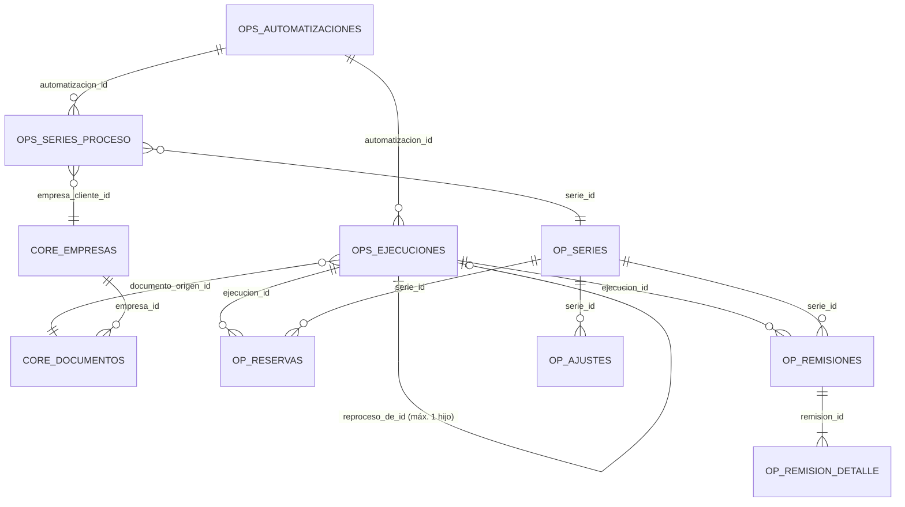

# Arquitectura de la base de datos

Fuentes: consultas de los repositorios (`apps/api/src/**/*.repository.ts`), migración 009 versionada, paquetes de migración externos (ver [migrations](migrations.md)).

## Esquemas

| Esquema | Propósito | Objetos relevantes (observados) |
| --- | --- | --- |
| `core` | Datos maestros y documentos | `empresas`, `empresa_roles`, `direcciones`, contactos y métodos, `documentos`; `fn_actualizar_updated_at`, `fn_crear_o_resolver_documento` |
| `ops` | Automatizaciones | `automatizaciones`, `ejecuciones_automatizacion`, `automatizacion_series_proceso`, `automation_trigger_requests`, `automation_review_acknowledgements`; funciones `fn_*` (abajo) |
| `operacion` | Documentos operativos y folios | `series_documentales`, `reservas_folios`, `remisiones`, `remision_detalle`, `ajustes_series`; funciones de reserva y persistencia |
| `security` | Acceso al Hub | `users`, `sessions` |
| `audit` | Auditoría genérica | `audit.fn_registrar_cambio` (trigger `AFTER` de auditoría), tabla de cambios que registra `app.request_id`, `app.user_id`, etc. |

## Modelo de automatizaciones (núcleo)

Leyenda: `OPS_*` = esquema `ops`; `OP_*` = esquema `operacion` (`OP_SERIES` = `series_documentales`, `OP_RESERVAS` = `reservas_folios`, `OP_AJUSTES` = `ajustes_series`); `CORE_*` = esquema `core`.

## Tablas del núcleo (propósito)

| Tabla | Propósito |
| --- | --- |
| `ops.automatizaciones` | Una fila por automatización (`codigo`, `nombre`, `estatus` `ACTIVA`/`INACTIVA`). Una automatización inactiva no permite crear ejecuciones. |
| `ops.ejecuciones_automatizacion` | Un intento de procesar un archivo origen. Estados `PROCESANDO`/`COMPLETADA`/`ERROR`/`CANCELADA`; contadores de reintento (`intentos_fallidos`, `max_intentos`); `reproceso_de_id`; `n8n_execution_id`. |
| `ops.automatizacion_series_proceso` | Rutas: `llave_proceso` → serie + cliente, con `estatus`. `UNIQUE(automatizacion_id, llave_proceso)`. Un trigger impide que una misma serie pertenezca a **dos automatizaciones distintas**. Es la **única autoridad** de propiedad automatización↔serie. |
| `ops.automation_trigger_requests` | Auditoría insert-only de acciones manuales hacia n8n. |
| `core.documentos` | Documento origen (archivo): `nombre_archivo`, `ruta_archivo`, `hash_archivo`, `origen`, `fecha_documento`. Índices únicos que reconocen versión por hash. |
| `operacion.series_documentales` | Serie: `codigo`, `siguiente_folio`, `estatus`, `folio_minimo_ajustable`. |
| `operacion.reservas_folios` | Rango de folios tomado por una ejecución en una serie. `UNIQUE(ejecucion_id, serie_id)`. Estados `RESERVADA`/`APLICADA`/`ABANDONADA`. |
| `operacion.remisiones` / `remision_detalle` | Remisión generada (`folio`, `pdf_path`, `estatus`) y sus renglones (`codigo_interno`, `part_number`, `descripcion`, `cantidad_texto`). |
| `operacion.ajustes_series` | Historial de ajustes manuales de `siguiente_folio`. |

Detalle de uso para Caterpillar: [database-contract.md](../automations/caterpillar/database-contract.md).

## Funciones (patrón)

Toda operación que n8n realiza sobre el modelo de automatizaciones pasa por **funciones `SECURITY DEFINER`** con `search_path` fijo, `REVOKE … FROM PUBLIC` y `GRANT EXECUTE` explícito al rol que corresponde. Esto permite que n8n opere con mínimo privilegio y que las reglas (idempotencia, ownership, integridad) vivan en PostgreSQL y no en el workflow.

| Función | Esquema | Propósito (una línea) |
| --- | --- | --- |
| `fn_resolver_ruta_automatizacion(codigo, llave)` | `ops` | Resuelve serie y cliente para una `llave_proceso` **activa**; sin fila si no existe o está inactiva. |
| `core.fn_crear_o_resolver_documento(...)` | `core` | Crea el documento origen o devuelve el existente (`ya_existia`). Reconoce versión por hash. |
| `fn_crear_ejecucion_automatizacion(...)` | `ops` | Crea/recupera una ejecución; devuelve `motivo` (`CREATED`, `ALREADY_PROCESSING`, `ALREADY_COMPLETED/ERROR/CANCELLED`, `REPROCESS_CREATED`, `ALREADY_REPROCESSED`). |
| `operacion.reservar_folios_para_ejecucion(...)` | `operacion` | Reserva un rango contiguo de folios de forma atómica e idempotente. |
| `operacion.fn_registrar_remision_generada(...)` | `operacion` | Persiste una remisión + renglones validando reserva y ownership; idempotente. |
| `fn_finalizar_ejecucion_automatizacion(...)` | `ops` | Cierra la ejecución (`COMPLETADA`/`ERROR`/`CANCELADA`) y aplica/abandona reservas; con chequeo de integridad. |
| `fn_registrar_fallo_ejecucion(...)` | `ops` | Registra un fallo de un intento n8n; tras `max_intentos` pasa a `ERROR`. |
| `fn_resolver_ejecucion_para_reproceso(id)` | `ops` | Lectura mínima para el webhook de reproceso (sólo Caterpillar). |

Firma exacta y responsabilidades: [database-contract.md](../automations/caterpillar/database-contract.md#funciones).
