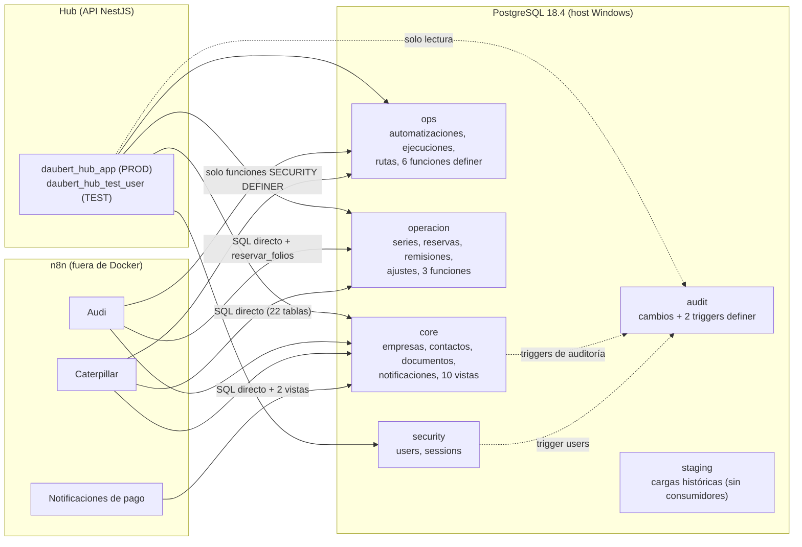
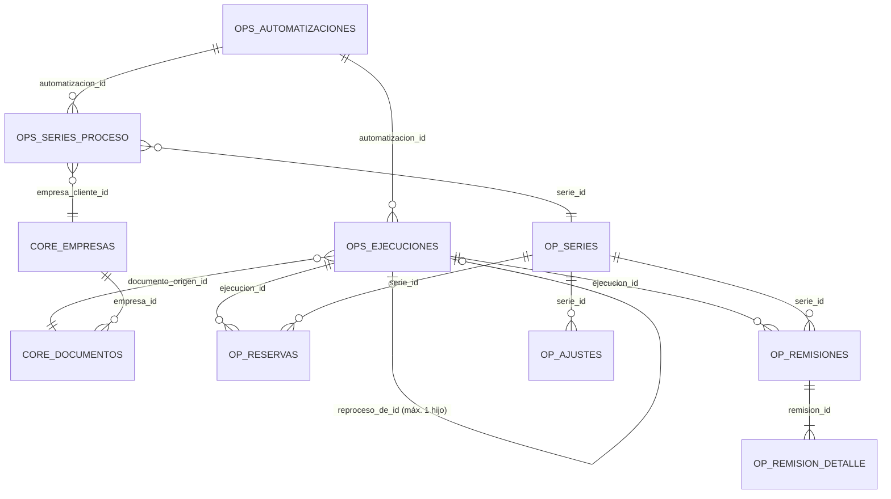

# Arquitectura de la base de datos

Fuentes: catálogo real de PostgreSQL 18.4 (PROD `daubert_global` y TEST `daubert_hub_test`, Fase D3, solo lectura), consultas de los repositorios (`apps/api/src/**/*.repository.ts`), exports n8n (D2), migración 009 versionada y paquetes externos (ver [migrations](migrations.md)). Portal: [README](README.md).

## Vista de alto nivel

Los triggers de auditoría (10) escriben en `audit.cambios` con funciones `SECURITY DEFINER`, así que ningún rol de aplicación necesita `INSERT` sobre `audit`. `staging` no lo usa nadie en runtime.

## Fronteras (boundaries)

| Schema | Frontera | Quién entra | Quién no |
| --- | --- | --- | --- |
| `core` | Datos maestros y documentos | Hub (CRUD acotado), n8n (`n8n_app`: documentos, notificaciones, vistas) | `daubert_docs_ro` (solo catálogo) |
| `ops` | Orquestación de automatizaciones | Hub (lectura + 2 `INSERT`), n8n (funciones y SQL directo Audi) | — |
| `operacion` | Folios y remisiones | Hub (lectura + ajuste de folio), n8n (funciones; `n8n_app` con `UPDATE` directo) | `n8n_cat_test` en TEST solo vía funciones |
| `security` | Identidad del Hub | **Solo el Hub** | n8n, roles de test de n8n |
| `audit` | Bitácora | Triggers (escritura); Hub (lectura) | Resto |
| `staging` | Aterrizaje de cargas históricas | **Nadie** (solo `postgres`) | Hub, n8n |

Detalle: [schemas/](schemas/README.md), [permissions-matrix](permissions-matrix.md), [roles](roles.md), [hub-contract](hub-contract.md), [n8n-contract](n8n-contract.md).

## Inventario real (D3)

| Concepto | PROD | TEST |
| --- | --- | --- |
| Schemas propios | 6 (+ `public` sin objetos) | 6 (+ `public`) |
| Tablas | 31 | 31 |
| Vistas | 10 (ninguna materializada) | 10 |
| Funciones | 13 (10 `SECURITY DEFINER`) | 13 |
| Triggers | 25 | 25 |
| Índices | 89 | 89 |
| Constraints (PK 29 · FK 33 · UNIQUE 11 · CHECK 88 · NOT NULL 181 = 342) | 342 | 342 |
| Sequences | 26 | 26 |
| Extensiones | `plpgsql` | `plpgsql` |
| Roles del proyecto | 6 | 6 (mismos, clúster único) |

Estructura idéntica en ambas bases; los grants son lo que difiere ([test-prod-drift](test-prod-drift.md)).

## Esquemas

| Esquema | Propósito | Ficha |
| --- | --- | --- |
| `core` | Datos maestros y documentos; modelo de notificaciones de pago; vistas | [core](schemas/core.md) |
| `ops` | Automatizaciones: catálogo, ejecuciones, rutas, disparos manuales, acuses; funciones `fn_*` | [ops](schemas/ops.md) |
| `operacion` | Series documentales, reservas de folios, remisiones, ajustes | [operacion](schemas/operacion.md) |
| `security` | Usuarios y sesiones del Hub | [security](schemas/security.md) |
| `audit` | `audit.cambios` y los triggers de auditoría (`fn_registrar_cambio`, `fn_registrar_cambio_security_users`) | [audit](schemas/audit.md) |
| `staging` | Cargas históricas (BIND, manufactura) sin consumidores | [staging](schemas/staging.md) |

## Modelo de automatizaciones (núcleo)

Leyenda: `OPS_*` = esquema `ops`; `OP_*` = esquema `operacion` (`OP_SERIES` = `series_documentales`, `OP_RESERVAS` = `reservas_folios`, `OP_AJUSTES` = `ajustes_series`); `CORE_*` = esquema `core`.

## Tablas del núcleo (propósito)

| Tabla | Propósito |
| --- | --- |
| `ops.automatizaciones` | Una fila por automatización (`codigo`, `nombre`, `estatus` `ACTIVA`/`INACTIVA`). Una automatización inactiva no permite crear ejecuciones. |
| `ops.ejecuciones_automatizacion` | Un intento de procesar un archivo origen. Estados `PROCESANDO`/`COMPLETADA`/`ERROR`/`CANCELADA`; contadores de reintento (`intentos_fallidos`, `max_intentos`); `reproceso_de_id`; `n8n_execution_id`. |
| `ops.automatizacion_series_proceso` | Rutas: `llave_proceso` → serie + cliente, con `estatus`. `UNIQUE(automatizacion_id, llave_proceso)`. Un trigger impide que una misma serie pertenezca a **dos automatizaciones distintas**. Es la **única autoridad** de propiedad automatización↔serie. |
| `ops.automation_trigger_requests` | Auditoría insert-only de acciones manuales hacia n8n. |
| `core.documentos` | Documento origen (archivo): `nombre_archivo`, `ruta_archivo`, `hash_archivo`, `origen`, `fecha_documento`. Índices únicos que reconocen versión por hash. |
| `operacion.series_documentales` | Serie: `codigo`, `siguiente_folio`, `estatus`, `folio_minimo_ajustable`. |
| `operacion.reservas_folios` | Rango de folios tomado por una ejecución en una serie. `UNIQUE(ejecucion_id, serie_id)`. Estados `RESERVADA`/`APLICADA`/`ABANDONADA`. |
| `operacion.remisiones` / `remision_detalle` | Remisión generada (`folio`, `pdf_path`, `estatus`) y sus renglones (`codigo_interno`, `part_number`, `descripcion`, `cantidad_texto`). |
| `operacion.ajustes_series` | Historial de ajustes manuales de `siguiente_folio`. |

Detalle de uso para Caterpillar: [database-contract.md](../automations/caterpillar/database-contract.md).

## Funciones (patrón)

Toda operación que el workflow de **Caterpillar** realiza sobre el modelo de automatizaciones pasa por **funciones `SECURITY DEFINER`** con `search_path` fijo, `REVOKE … FROM PUBLIC` y `GRANT EXECUTE` explícito al rol que corresponde. Esto permite operar con mínimo privilegio y que las reglas (idempotencia, ownership, integridad) vivan en PostgreSQL y no en el workflow. **Verificado en D3:** el workflow de **Audi** y el de **Notificaciones de pago** *no* usan ese patrón (SQL directo; Audi solo llama al allocator legado `operacion.reservar_folios`, `SECURITY INVOKER`), por lo que `n8n_app` conserva privilegios directos de tabla ([n8n-app-audit](../database/n8n-app-audit.md)). Catálogo completo de las 13 funciones: [functions/](functions/README.md); clasificación de seguridad: [security-definer](security-definer.md).

| Función | Esquema | Propósito (una línea) |
| --- | --- | --- |
| `fn_resolver_ruta_automatizacion(codigo, llave)` | `ops` | Resuelve serie y cliente para una `llave_proceso` **activa**; sin fila si no existe o está inactiva. |
| `core.fn_crear_o_resolver_documento(...)` | `core` | Crea el documento origen o devuelve el existente (`ya_existia`). Reconoce versión por hash. |
| `fn_crear_ejecucion_automatizacion(...)` | `ops` | Crea/recupera una ejecución; devuelve `motivo` (`CREATED`, `ALREADY_PROCESSING`, `ALREADY_COMPLETED/ERROR/CANCELLED`, `REPROCESS_CREATED`, `ALREADY_REPROCESSED`). |
| `operacion.reservar_folios_para_ejecucion(...)` | `operacion` | Reserva un rango contiguo de folios de forma atómica e idempotente. |
| `operacion.fn_registrar_remision_generada(...)` | `operacion` | Persiste una remisión + renglones validando reserva y ownership; idempotente. |
| `fn_finalizar_ejecucion_automatizacion(...)` | `ops` | Cierra la ejecución (`COMPLETADA`/`ERROR`/`CANCELADA`) y aplica/abandona reservas; con chequeo de integridad. |
| `fn_registrar_fallo_ejecucion(...)` | `ops` | Registra un fallo de un intento n8n; tras `max_intentos` pasa a `ERROR`. |
| `fn_resolver_ejecucion_para_reproceso(id)` | `ops` | Lectura mínima para el webhook de reproceso (sólo Caterpillar). |

Firma exacta y responsabilidades: [database-contract.md](../automations/caterpillar/database-contract.md#funciones).
