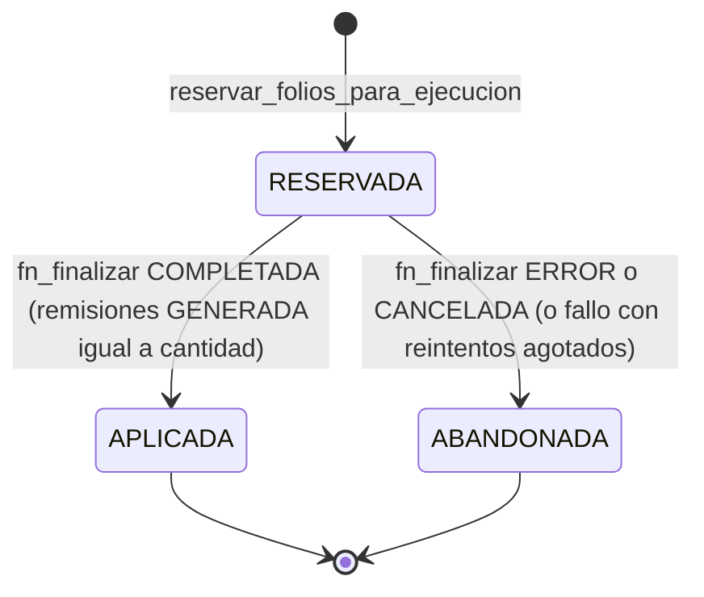
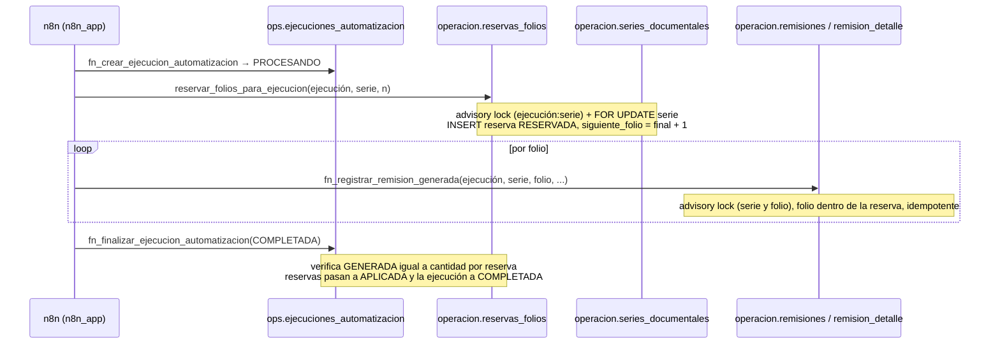

# Folios: arquitectura detallada en PostgreSQL

Fuentes (todas de solo lectura): definiciones de `operacion.*`/`ops.*` con `pg_get_functiondef()`, `pg_constraint`, `pg_index`, `pg_trigger` en PROD y TEST; código del Hub (`document-series.repository.ts`); exports n8n D2. Complementa —sin reemplazar— [document-series](document-series.md) (D1, comportamiento y ajuste desde el Hub). Volver a [database](README.md).

> Alcance de la verificación: se confirmó **estructura y reglas**. Los **valores** (`siguiente_folio` actual, pisos, series existentes, ejecuciones en `PROCESANDO`, reservas huérfanas) **no** se leyeron: `daubert_docs_ro` no tiene `SELECT` en tablas de negocio. Para valores usar el Hub (pantalla Series) o un rol con permiso.

## Objetos

| Objeto | Rol | Ficha |
| --- | --- | --- |
| `operacion.series_documentales` | Contador por serie (`codigo` único en mayúsculas). Columnas clave: `siguiente_folio` (`> 0`), `estatus` (`ACTIVA`/`INACTIVA`), `folio_minimo_ajustable` (piso, `> 0` o `NULL`) | [ficha](tables/operacion.series_documentales.md) |
| `operacion.reservas_folios` | Rango `[folio_inicial, folio_final]` tomado por una ejecución en una serie; `UNIQUE(ejecucion_id, serie_id)`; estados `RESERVADA`/`APLICADA`/`ABANDONADA` | [ficha](tables/operacion.reservas_folios.md) |
| `operacion.remisiones` | Remisión emitida (`serie_id`, `folio`, `ejecucion_id`, `empresa_cliente_id`, `estatus` `PENDIENTE`/`GENERADA`/`CANCELADA`) | [ficha](tables/operacion.remisiones.md) |
| `operacion.remision_detalle` | Renglones de la remisión | [ficha](tables/operacion.remision_detalle.md) |
| `operacion.ajustes_series` | Libro de ajustes manuales del Hub (folio anterior → nuevo, motivo, usuario) | [ficha](tables/operacion.ajustes_series.md) |
| `ops.automatizacion_series_proceso` | Ruta proceso → serie → cliente; define qué series puede usar cada automatización | [ficha](tables/ops.automatizacion_series_proceso.md) |
| `ops.ejecuciones_automatizacion` | Dueña de las reservas y remisiones (FK) | [ficha](tables/ops.ejecuciones_automatizacion.md) |

Funciones: [`reservar_folios_para_ejecucion`](functions/operacion.reservar_folios_para_ejecucion.md), [`fn_registrar_remision_generada`](functions/operacion.fn_registrar_remision_generada.md), [`fn_finalizar_ejecucion_automatizacion`](functions/ops.fn_finalizar_ejecucion_automatizacion.md), [`fn_registrar_fallo_ejecucion`](functions/ops.fn_registrar_fallo_ejecucion.md) y el legado [`reservar_folios`](functions/operacion.reservar_folios.md) ([comparación](audi-legacy-allocator.md)).

> **Serie documental ≠ sequence de PostgreSQL.** El folio de negocio vive en `series_documentales.siguiente_folio` (una fila), no en una `SEQUENCE`. Ver [sequences](sequences.md).

## Semántica de `siguiente_folio`

- Es el **próximo folio libre**. Solo lo avanzan `reservar_folios_para_ejecucion` (Caterpillar) y `reservar_folios` (Audi legado), ambos `siguiente_folio = folio_final + 1`.
- Solo retrocede/avanza por **ajuste manual** del Hub (`UPDATE` + `INSERT` en `ajustes_series`, misma transacción). La base **no** impone ese camino: `daubert_hub_app` y `n8n_app` tienen `UPDATE` de tabla completa y no hay trigger que exija la fila en `ajustes_series` ni el piso.
- `folio_minimo_ajustable` ("folio mínimo ajustable"): el propio `COMMENT` de la columna documenta que es un piso histórico/de corte para ajustes hacia atrás; `NULL` = sin configurar → el Hub **falla cerrado**. La regla la hace cumplir **el Hub**, no la base (no hay `CHECK` que relacione `siguiente_folio` con el piso).
- Abandonar una reserva **no** devuelve folios: `fn_finalizar_ejecucion_automatizacion` con `ERROR`/`CANCELADA` marca `ABANDONADA` y **no toca** `siguiente_folio` (lo dice el comentario de la versión TEST de la función; el código PROD hace lo mismo).

## Estados

`ck_reservas_folios_finalizada_en` obliga a que `finalizada_en` sea `NULL` solo en `RESERVADA`. No existe función de "cancelar reserva" aparte de esta finalización.

**Cancelación de remisiones:** `operacion.remisiones.estatus` admite `CANCELADA` (y el índice único la excluye para liberar el folio), pero **ninguna función, trigger, workflow exportado ni código del Hub** pasa una remisión a `CANCELADA` (el Hub solo hace `SELECT`; `n8n_app` tiene `UPDATE` pero no lo usa). Cómo se cancela hoy: **UNKNOWN** (probablemente `UPDATE` manual con `postgres`).

## Ruta ejecución → reserva → remisión (Caterpillar)

Rama de fallo: `fn_registrar_fallo_ejecucion` cuenta intentos; al llegar a `max_intentos` llama a `fn_finalizar(ERROR)` → reservas `ABANDONADA`, ejecución `ERROR`.

## Concurrencia y bloqueos (verificado en las definiciones)

| Operación | Mecanismo | Qué serializa |
| --- | --- | --- |
| `reservar_folios_para_ejecucion` | `pg_advisory_xact_lock(hashtextextended(ejecucion_id:serie_id, 0))` y luego `SELECT … FOR UPDATE` de la fila de la serie | Dos reintentos de la misma (ejecución, serie) (antes de que exista fila que bloquear); y dos ejecuciones distintas sobre la misma serie |
| `fn_registrar_remision_generada` | `pg_advisory_xact_lock(hashtextextended(serie_id:folio, 0))` | Dos registros del mismo (serie, folio) |
| `fn_finalizar_ejecucion_automatizacion` / `fn_registrar_fallo_ejecucion` | `SELECT … FOR UPDATE` de la ejecución | Finalizaciones/fallos concurrentes de la misma ejecución |
| `reservar_folios` (legado) | `SELECT … FOR UPDATE` de la serie por `codigo` | Dos allocaciones simultáneas de la misma serie |
| Ajuste del Hub | `FOR UPDATE OF series` en el repositorio (D1) + `expectedCurrentFolio` | Ajuste vs. n8n |

Los locks advisory son de **transacción** (se liberan en `COMMIT`/`ROLLBACK`). Las 6 funciones con hash distinto entre TEST y PROD ([drift](test-prod-drift.md#funciones)) difieren solo en comentarios; en particular el comentario de TEST sobre `reservar_folios_para_ejecucion` describe exactamente este lock, que el código PROD también contiene.

## Constraints e índices que protegen los folios

| Regla | Mecanismo |
| --- | --- |
| Un folio activo por serie | índice único parcial `uq_remisiones_serie_folio_no_cancelada` (`WHERE estatus <> 'CANCELADA'`) |
| Reserva coherente | `ck_reservas_folios_rango_coherente` (`folio_final = folio_inicial + cantidad − 1`), `_folio_inicial > 0`, `_cantidad > 0`, `_folio_final >= _folio_inicial` |
| Una reserva por (ejecución, serie) | `uq_reservas_folios_ejecucion_serie` |
| Reserva ↔ estado | `ck_reservas_folios_finalizada_en` |
| Serie única, en mayúsculas | `uq_series_documentales_codigo`, `ck_series_documentales_codigo` |
| Ajustes válidos | `ck_ajustes_series_folio_anterior/nuevo > 0`, `ck_ajustes_series_folios_distintos`, `ck_ajustes_series_motivo` |
| Nada se borra en cascada | Todas las FK de este dominio son `ON DELETE RESTRICT` |

**Lo que la base NO impide** (por diseño actual): solapes entre rangos de reservas de una misma serie (no hay `EXCLUDE`; solo la monotonía de `siguiente_folio` los evita); que `siguiente_folio` baje por debajo de folios ya usados con un `UPDATE` directo; que dos ejecuciones distintas usen la misma serie si ambas la tienen como ruta.

## Auditoría de folios

- `ajustes_series` es el libro de ajustes **del Hub** (con usuario y motivo).
- Las reservas de Caterpillar dejan rastro por ejecución (`reservas_folios` + `remisiones.ejecucion_id`).
- **No** hay trigger de `audit.cambios` en `operacion.*`: un `UPDATE` directo de `siguiente_folio`, o el avance del allocator legado, no queda en `audit.cambios`.
- Audi (legado) no deja reserva: el único rastro de folios consumidos son las remisiones insertadas.

## Riesgos

1. **Doble camino de escritura de `siguiente_folio`** (Hub, allocator legado, funciones definer, `UPDATE` directo permitido a `n8n_app`) sin trigger que lo audite.
2. **Folios consumidos sin rastro** cuando Audi falla tras `reservar_folios`: solo se ven como saltos en la numeración. Un ajuste hacia atrás del Hub compara contra remisiones y reservas existentes; un folio consumido sin remisión ni reserva **no** lo detecta (por eso el Hub exige revisar el filesystem).
3. `reservar_folios_para_ejecucion` no verifica que el rango no choque con remisiones existentes (a diferencia de `reservar_folios`); depende de que el contador nunca retroceda por debajo de folios usados.
4. Cancelación de remisiones: procedimiento no definido en la base (UNKNOWN).
5. Piso `folio_minimo_ajustable` solo lo respeta el Hub.

Ver también: [audi-legacy-allocator](audi-legacy-allocator.md), [troubleshooting](troubleshooting.md#folio-que-no-avanza), [integrity-rules](integrity-rules.md).
