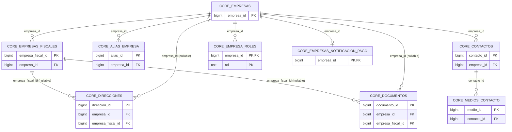
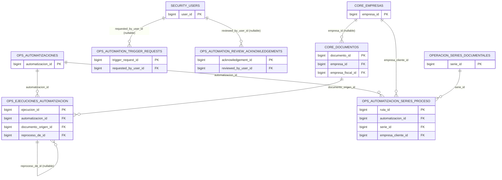
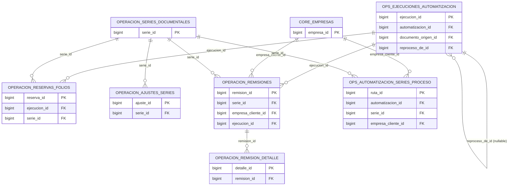
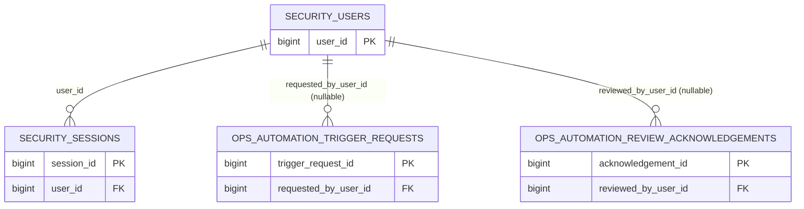
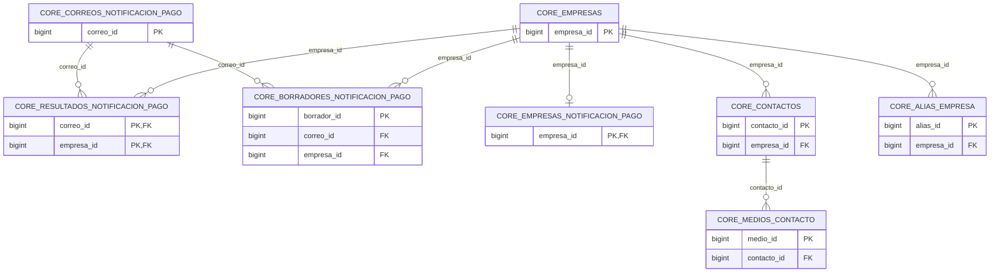
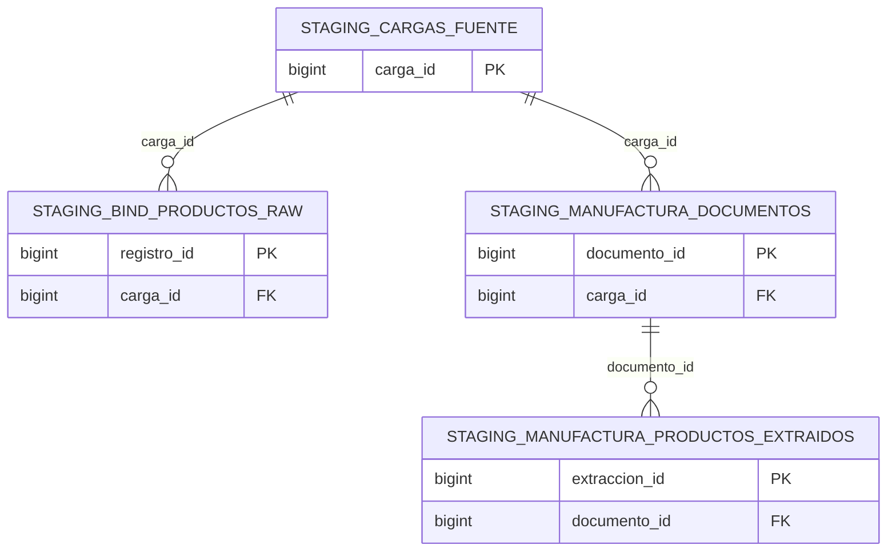

# Relaciones (ER por dominio)

Fuente: 342 constraints leídas de `pg_constraint` (incluye las 29 PK y las FK), idénticas en PROD y TEST. Los diagramas muestran solo columnas PK/FK, y se dividen en 6 dominios para mantenerlos legibles. Cardinalidad: `||--o{` = uno a muchos; `||--o|` = uno a cero/uno (FK con índice único). Volver a [database](README.md).

## 1. Empresas y contactos

`core.documentos` y `core.direcciones` pertenecen a **una** empresa **o** a **una** empresa fiscal (CHECK XOR). `core.empresas_notificacion_pago` es 1:1 con `core.empresas`. `ON DELETE CASCADE` desde `empresas` hacia alias, contactos (y sus medios), roles, direcciones, documentos y config de notificaciones; `RESTRICT` hacia `empresas_fiscales`.

## 2. Automatizaciones

`ejecuciones_automatizacion.reproceso_de_id` es una FK a la misma tabla (con índice único parcial: un solo hijo por padre; el diagrama la muestra como relación reflexiva implícita en la tabla). Las tablas de disparo/acuse apuntan a `security.users` con `SET NULL`.

## 3. Folios y remisiones

Todas las FK de este dominio son `ON DELETE RESTRICT`: ni series, ni ejecuciones, ni empresas con folios/remisiones se pueden borrar. Ruta ejecución → reserva → remisión: ver [folios](folios.md).

## 4. Seguridad y autenticación

`audit.cambios` **no tiene FK** (referencia lógica por `esquema`/`tabla`/`registro_id` textual y `usuario_id` textual): por eso no aparece como entidad relacionada. `sessions` se borra en cascada con el usuario.

## 5. Notificaciones de pago

Las tablas `*_notificacion_pago` de correos/resultados/borradores usan `NO ACTION` hacia `empresas`. El catálogo que ve n8n se construye con las vistas `core.vw_contactos_notificacion_pago_n8n` y `core.vw_catalogo_notificacion_pago_n8n` sobre `empresas`, `empresas_notificacion_pago`, `contactos`, `medios_contacto` y `alias_empresa` ([vistas](views/README.md)).

## 6. Staging / manufactura

Dominio coherente y **aislado**: sus 3 FK son internas al esquema `staging`; no hay FK hacia `core`/`ops`/`operacion`.

## Inventario completo de foreign keys (33)

| tabla | columna(s) | referencia | ON DELETE | constraint |
| --- | --- | --- | --- | --- |
| `core.alias_empresa` | `empresa_id` | `core.empresas(empresa_id)` | CASCADE | `alias_empresa_empresa_id_fkey` |
| `core.borradores_notificacion_pago` | `correo_id` | `core.correos_notificacion_pago(correo_id)` | NO ACTION | `borradores_notificacion_pago_correo_id_fkey` |
| `core.borradores_notificacion_pago` | `empresa_id` | `core.empresas(empresa_id)` | NO ACTION | `borradores_notificacion_pago_empresa_id_fkey` |
| `core.contactos` | `empresa_id` | `core.empresas(empresa_id)` | CASCADE | `contactos_empresa_id_fkey` |
| `core.direcciones` | `empresa_fiscal_id` | `core.empresas_fiscales(empresa_fiscal_id)` | CASCADE | `direcciones_empresa_fiscal_id_fkey` |
| `core.direcciones` | `empresa_id` | `core.empresas(empresa_id)` | CASCADE | `direcciones_empresa_id_fkey` |
| `core.documentos` | `empresa_fiscal_id` | `core.empresas_fiscales(empresa_fiscal_id)` | CASCADE | `documentos_empresa_fiscal_id_fkey` |
| `core.documentos` | `empresa_id` | `core.empresas(empresa_id)` | CASCADE | `documentos_empresa_id_fkey` |
| `core.empresa_roles` | `empresa_id` | `core.empresas(empresa_id)` | CASCADE | `empresa_roles_empresa_id_fkey` |
| `core.empresas_fiscales` | `empresa_id` | `core.empresas(empresa_id)` | RESTRICT | `empresas_fiscales_empresa_id_fkey` |
| `core.empresas_notificacion_pago` | `empresa_id` | `core.empresas(empresa_id)` | CASCADE | `empresas_notificacion_pago_empresa_id_fkey` |
| `core.medios_contacto` | `contacto_id` | `core.contactos(contacto_id)` | CASCADE | `medios_contacto_contacto_id_fkey` |
| `core.resultados_notificacion_pago` | `correo_id` | `core.correos_notificacion_pago(correo_id)` | CASCADE | `fk_resultado_correo` |
| `core.resultados_notificacion_pago` | `empresa_id` | `core.empresas(empresa_id)` | NO ACTION | `fk_resultado_empresa` |
| `operacion.ajustes_series` | `serie_id` | `operacion.series_documentales(serie_id)` | RESTRICT | `fk_ajustes_series_serie` |
| `operacion.remision_detalle` | `remision_id` | `operacion.remisiones(remision_id)` | RESTRICT | `fk_remision_detalle_remision` |
| `operacion.remisiones` | `ejecucion_id` | `ops.ejecuciones_automatizacion(ejecucion_id)` | RESTRICT | `fk_remisiones_ejecucion` |
| `operacion.remisiones` | `empresa_cliente_id` | `core.empresas(empresa_id)` | RESTRICT | `fk_remisiones_empresa_cliente` |
| `operacion.remisiones` | `serie_id` | `operacion.series_documentales(serie_id)` | RESTRICT | `fk_remisiones_serie` |
| `operacion.reservas_folios` | `ejecucion_id` | `ops.ejecuciones_automatizacion(ejecucion_id)` | RESTRICT | `fk_reservas_folios_ejecucion` |
| `operacion.reservas_folios` | `serie_id` | `operacion.series_documentales(serie_id)` | RESTRICT | `fk_reservas_folios_serie` |
| `ops.automation_review_acknowledgements` | `reviewed_by_user_id` | `security.users(user_id)` | SET NULL | `fk_automation_review_acknowledgements_user` |
| `ops.automation_trigger_requests` | `requested_by_user_id` | `security.users(user_id)` | SET NULL | `fk_automation_trigger_requests_user` |
| `ops.automatizacion_series_proceso` | `automatizacion_id` | `ops.automatizaciones(automatizacion_id)` | RESTRICT | `fk_automatizacion_series_proceso_automatizacion` |
| `ops.automatizacion_series_proceso` | `empresa_cliente_id` | `core.empresas(empresa_id)` | RESTRICT | `fk_automatizacion_series_proceso_empresa_cliente` |
| `ops.automatizacion_series_proceso` | `serie_id` | `operacion.series_documentales(serie_id)` | RESTRICT | `fk_automatizacion_series_proceso_serie` |
| `ops.ejecuciones_automatizacion` | `automatizacion_id` | `ops.automatizaciones(automatizacion_id)` | RESTRICT | `fk_ejecuciones_automatizacion_automatizacion` |
| `ops.ejecuciones_automatizacion` | `documento_origen_id` | `core.documentos(documento_id)` | RESTRICT | `fk_ejecuciones_automatizacion_documento` |
| `ops.ejecuciones_automatizacion` | `reproceso_de_id` | `ops.ejecuciones_automatizacion(ejecucion_id)` | RESTRICT | `fk_ejecuciones_automatizacion_reproceso` |
| `security.sessions` | `user_id` | `security.users(user_id)` | CASCADE | `fk_sessions_user` |
| `staging.bind_productos_raw` | `carga_id` | `staging.cargas_fuente(carga_id)` | NO ACTION | `bind_productos_raw_carga_id_fkey` |
| `staging.manufactura_documentos` | `carga_id` | `staging.cargas_fuente(carga_id)` | NO ACTION | `manufactura_documentos_carga_id_fkey` |
| `staging.manufactura_productos_extraidos` | `documento_id` | `staging.manufactura_documentos(documento_id)` | NO ACTION | `manufactura_productos_extraidos_documento_id_fkey` |

## Tablas sin relaciones FK

`audit.cambios`, `core.snapshot_carga_empresas_inicial`, `core.stg_contactos_notificacion_pago` (`audit.cambios`, `core.snapshot_carga_empresas_inicial`, `core.stg_contactos_notificacion_pago`).
