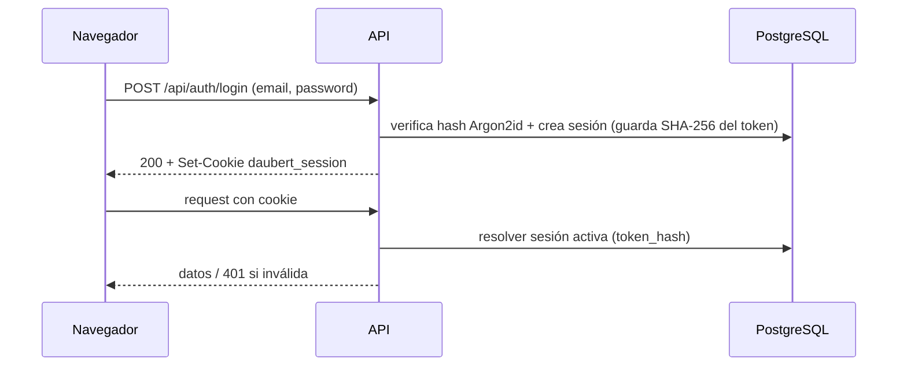

# Autenticación

Fuentes: `apps/api/src/security/*`, `apps/api/scripts/*`, `apps/web/src/auth/*`, `services/httpInterceptor.ts`. Sin valores secretos.

## Modelo

- **Sesión server-side** en PostgreSQL (`security.sessions`). El navegador sólo guarda un token opaco.
- Token: 256 bits aleatorios (`base64url`). En BD se guarda **sólo SHA-256 del token** (`token_hash`); el token en claro nunca se persiste.
- Cookie `daubert_session`: `HttpOnly`, `SameSite=Strict`, `path=/api`, `Secure` según `AUTH_COOKIE_SECURE` (configuración explícita; no se infiere de cabeceras).
- **Vida absoluta de 12 horas**, sin renovación ni refresh tokens.
- En cada request se revalida contra PostgreSQL: no revocada, no expirada y usuario `ACTIVE`.
- Contraseñas: **Argon2id**. Política mínima: 12 caracteres, no en blanco.

## Flujo

Si el usuario tiene `mustChangePassword = true`, la web lo envía a `/change-password` y la API responde `403 PASSWORD_CHANGE_REQUIRED` en cualquier ruta de negocio; sólo `GET /auth/me` y `POST /auth/change-password` están permitidas.

## Protección CSRF por Origin (Fase 8B)

Defensa en profundidad además de `SameSite=Strict`. Sólo aplica a `POST/PUT/PATCH/DELETE`:

1. `Sec-Fetch-Site: cross-site` → `403 CSRF_ORIGIN_NOT_ALLOWED`.
2. Si hay `Origin`, su host:puerto debe coincidir (sin distinguir mayúsculas) con el header `Host` de la request; si no → 403. El esquema se ignora a propósito (TLS puede terminar en un túnel).
3. Sin ninguno de los dos headers (clientes no navegador: curl, runners de prueba, n8n si llamara) → se permite.

Por eso Nginx **preserva el `Host` original** hacia la API (`proxy_set_header Host $http_host`).

## Rate limit de login (Fase 8A)

Política "10 fallos, luego sondas": tras 10 fallos por email normalizado en 15 min, sólo se permite **una** verificación de credenciales por minuto; el resto recibe `429 LOGIN_RATE_LIMITED` (con `Retry-After`) antes de gastar CPU en Argon2. Limitación conocida documentada en el código: la "sonda" es compartida y no está ligada a una identidad de cliente confiable.

## Creación y recuperación del ADMIN

No existe registro público ni endpoint HTTP de bootstrap. Scripts en `apps/api/scripts` (ejecutados por un operador con acceso al servidor):

| Script npm (`--workspace=@daubert/api`) | Uso | Guards |
| --- | --- | --- |
| `security:bootstrap-admin` | Primer `ADMIN` en TEST | Sólo `daubert_hub_test` |
| `security:bootstrap-admin:prod` | Primer `ADMIN` en PROD | Sólo `daubert_global`, rol `daubert_hub_app`, tablas existentes y **cero usuarios** previos |
| `security:reset-admin-password` / `:prod` | Recuperar contraseña de un `ADMIN` | Mismos guards de base/rol; reutiliza el mismo hashing y la misma transacción que el endpoint ADMIN de reset (revoca sesiones, exige cambio de contraseña) |

Datos de entrada por variables de entorno temporales o prompt oculto; nunca por argumentos de línea de comandos, y nunca se imprimen contraseñas, hashes ni URLs de conexión. Consulta el encabezado de cada script para los nombres exactos de variables.

## Hardening adicional presente en el código

- `helmet` (CSP restrictiva), `X-Request-Id` server-side, errores 5xx sanitizados.
- Respuestas de login genéricas (no revelan si el email existe).
